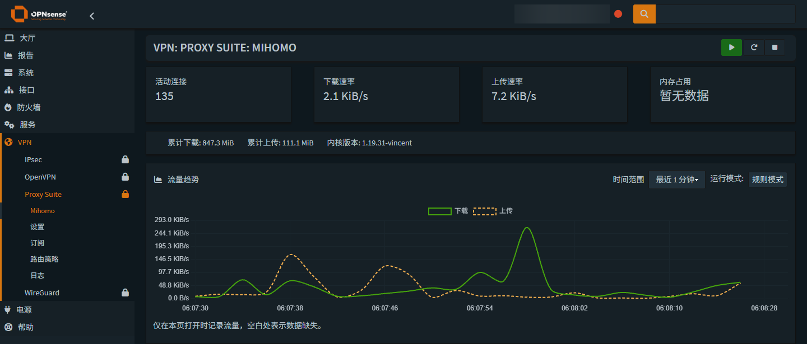

# os-mihomo

[简体中文](README.md) · [Releases](https://github.com/Thweki/os-mihomo/releases) · [Report an issue](https://github.com/Thweki/os-mihomo/issues)

os-mihomo is a third-party OPNsense plugin. It brings Mihomo proxy groups, connections, traffic and logs into the OPNsense WebGUI, where you can edit configuration, update subscriptions and manage routing policies per interface. After installation, open **VPN → Proxy Suite → Mihomo**.

## Install

The target is **OPNsense 26.7 on FreeBSD 15 amd64**. If a trusted signed repository provides the plugin, install `os-mihomo` under **System → Firmware → Plugins**. Otherwise, follow the guide to verify the `.pkg` from an official project release and install it with the OPNsense package manager. [Installation, upgrades and removal](docs/install.en.md)

On a fresh installation, Mihomo stays stopped and start at boot is disabled. Validate your own configuration before starting it. If you plan to route client traffic through Mihomo, review the TUN, routing and DNS settings first. [First-time setup and everyday use](docs/usage.en.md#first-time-setup)

## More documentation

- Test proxies, inspect connections, update subscriptions or compare configuration. [Everyday use and troubleshooting](docs/usage.en.md)
- Build from source, verify a release or distribute your own packages. [Build, CI and signed repositories](docs/ci-cd.md)
- See how the UI distinguishes saved configuration from loaded firewall rules. [Routing evidence and tests](docs/audit-b7.md)

This project builds on Opnwall's plugin assets and uses the MetaCubeX/mihomo core, built for FreeBSD by Vincent-Loeng. [Original plugin](https://github.com/Opnwall/OPNsense-repo) · [Core source](https://github.com/MetaCubeX/mihomo) · [FreeBSD core build](https://github.com/Vincent-Loeng/clash-meta)
