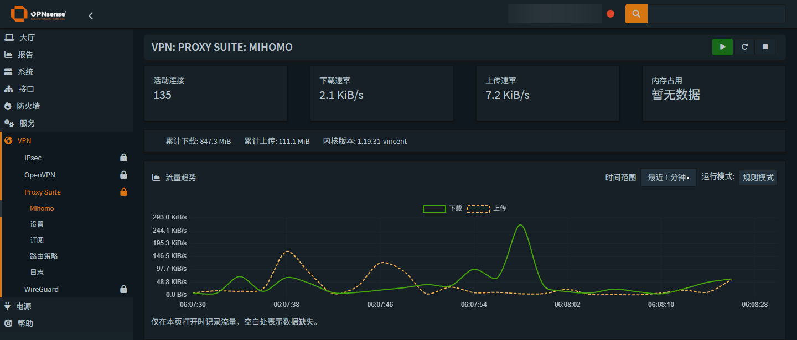
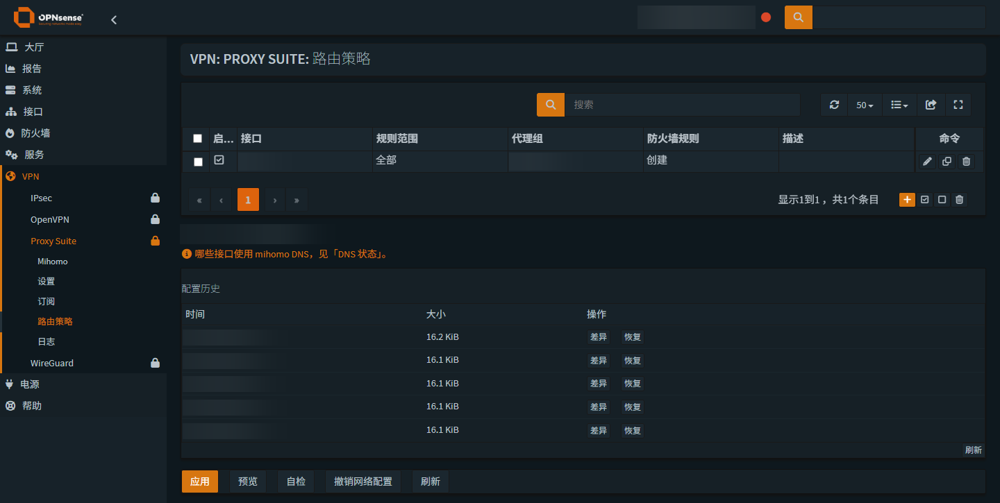
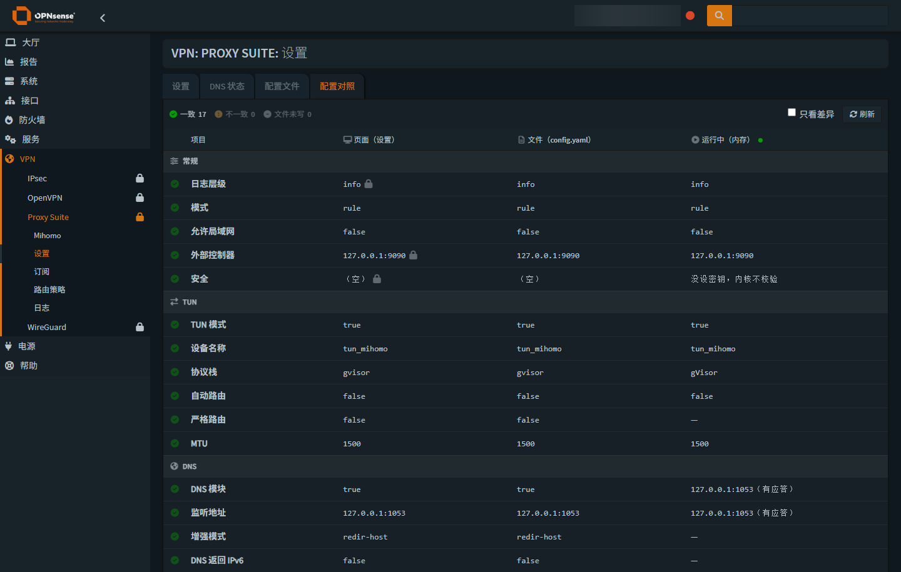

# os-mihomo

**Native Mihomo management for OPNsense.**

[](https://github.com/Thweki/os-mihomo/actions/workflows/ci.yml)
[简体中文](README.md)

os-mihomo brings traffic monitoring, proxy groups, configuration, subscriptions and routing policies into the OPNsense WebGUI. It uses native OPNsense MVC pages, forms and tables, inherits the active system theme, and includes English and Simplified Chinese interfaces.

Browser requests go through the OPNsense plugin API. The server connects to the Mihomo controller over loopback with its authentication secret. No controller port needs to be exposed to the browser, and no embedded third-party dashboard or separate web server is required.

## Features

Open **VPN → Proxy Suite** after installation.

| Page | Capabilities |
| --- | --- |
| Mihomo overview | Live rates, traffic totals, active connections, process memory, current forwarding, proxy groups, latency tests, runtime mode and service status |
| Settings | Native forms, write locks, change previews and discard, reapply, advanced options, YAML editing and validation, configuration comparison and DNS status |
| Policy Routing | Current forwarding and rule details; interface policies, change previews, network bindings, configuration history and restore |
| Subscription | Submit updates; view task state, last success, exit code and execution logs |
| Log File | Filter loaded lines, pause refresh, switch sources and line counts, download or clear logs |

Traffic charts cover the last **1 minute, 5 minutes, 15 minutes or 1 hour**, with values shown to one decimal place. Samples are collected while the overview is open, and missing samples leave gaps. There is no background long-term traffic storage. Charts follow the active OPNsense theme without a separate theme switch.

Current forwarding is a read-only view of loaded PF rules, preserving address families, directions, port limits and exceptions. Rule order and core policies still affect traffic; DNS paths describe configuration and require a client query to confirm reachability. Process memory reports the core's RSS.



These screenshots show the actual interface with sensitive information blurred by a local script. Colors inherit the system theme; pictured configuration values illustrate the interface only.

## Requirements

| Component | Current version / target |
| --- | --- |
| Plugin | `1.1.0` |
| OPNsense | `26.7` series |
| Build environment | FreeBSD `15.1`, `amd64` |
| Mihomo core | `1.19.31-vincent` |
| Package dependencies | `curl`, `jq` |

Other system versions and architectures require separate validation. Pinned sources and checksums are recorded in the [core manifest](packaging/freebsd/binary-source.json) and [Geo data manifest](packaging/freebsd/geodata-source.json).

## Installation

### Install a build artifact

1. Open [GitHub Actions](https://github.com/Thweki/os-mihomo/actions/workflows/ci.yml), select a successful build and download its `os-mihomo-freebsd15-amd64` artifact.
2. Extract it and place `os-mihomo.pkg`, `os-mihomo-repository.tar.gz` and `SHA256SUMS` together on the target system. The artifact also includes a `package-files.txt` inventory.
3. From that directory, verify and install as an administrator:

```sh
# Verify both archives; stop if either checksum fails.
while read -r expected file; do
    sha256 -c "$expected" "$file" || exit 1
done < SHA256SUMS

pkg install -y curl jq
pkg add os-mihomo.pkg

# Load the plugin's backend actions into OPNsense.
service configd restart
```

**Fresh installations disable autostart and do not start Mihomo.** Installation hooks do not create interfaces or firewall rules, or change routing or DNS. Configuration ships as `.sample` files and is copied only when the corresponding live file is absent. Existing configuration and autostart settings are preserved.

The bundled YAML contains example nodes and credentials. Complete the initial configuration below before starting the service.

### Distribute through the plugin manager

Maintainers can extract the repository archive to a static file server, preserving its ABI subdirectory. Edit the included `os-mihomo.conf` so its `url` points to the directory containing `meta.conf`, then place the configuration in `/usr/local/etc/pkg/repos/` on the target system.

After refreshing repository metadata, manage `os-mihomo` under **System → Firmware → Plugins**. Supply your own repository URL: the build produces repository files but does not provision a hosted package source. See [CI/CD](docs/ci-cd.md).

## Initial configuration

1. **Prepare a working configuration.** Edit Mihomo YAML in Settings, or enter subscription details and run an update from Subscription. Check nodes, proxy groups, the controller secret and listening address. A loopback listener is sufficient for the WebUI.
2. **Choose which values the form manages.** YAML fields have lock icons. A locked field preserves the file value on Apply; an unlocked field allows the form to write it. Fixed fields cannot be edited. Plugin settings such as autostart and subscriptions are separate from these YAML locks.
3. **Validate before starting.** Use configuration validation and comparison, and review TUN, automatic routing and DNS options. Then start Mihomo using the service controls. Starting or stopping the service is separate from enabling autostart.
4. **Add routing policies as needed.** Select an interface and proxy group, preview the changes, then apply. Asking the plugin to create firewall rules also involves OPNsense interface, gateway and firewall configuration. With manual management, you must arrange for traffic to reach Mihomo yourself.
5. **Check the running result.** Use the overview, active connections, DNS status and logs. Form, file and runtime values can differ; Configuration comparison shows those differences.

Once network policies are active, affected traffic may depend on Mihomo continuing to run. Remove that dependency before stopping the service or uninstalling the plugin.



## Configuration and maintenance

### Forms, YAML and runtime state

Saved form settings, YAML on disk and the core's running configuration are managed separately. Apply writes permitted fields to the file and synchronizes plugin settings. Saving a file does not mean the running core has loaded it; explicitly request a restart when needed.

The advanced YAML editor starts in read-only mode. Unlock it to edit and review changes before saving. The server validates the new configuration and backs up the old file before replacing it. DNS status and Configuration comparison are read-only views.



### Subscription updates

Subscription updates regenerate `config.yaml` from the subscription template and can overwrite manual edits. Changes that must survive updates should also be reflected in the template. After submitting an update, check the subscription log for its result.

| File | Purpose |
| --- | --- |
| `/usr/local/etc/mihomo/config.yaml` | Mihomo configuration file |
| `/usr/local/etc/mihomo/sub/template_config.yaml` | Subscription generation template |
| `/usr/local/etc/mihomo/sub/env` | Subscription parameters and credentials |
| `/etc/rc.conf.d/mihomo` | Autostart setting |
| `/var/log/mihomo.log` | Core log |
| `/var/log/mihomo_sub.log` | Subscription task log |

### Upgrades, migration and removal

Back up the OPNsense configuration and Mihomo configuration files before upgrading. When migrating from another package with the same name, inspect its uninstall hooks for cleanup actions that could affect existing network settings.

This version retains user configuration and network settings on removal and does not stop the service automatically. Remove dependent network policies and stop Mihomo before uninstalling. Retained configuration is available for later recovery.

### Troubleshooting

- **The page opens but has no runtime data:** Check that Mihomo is running, its controller is reachable over loopback, and the port and secret in the current file match the running instance.
- **A form change did not update the file:** Check the field's lock. Only unlocked YAML fields are written by the form.
- **The file changed but runtime values are old:** Configuration comparison exposes this difference. Review the changes, then reload the service configuration.
- **Backend actions are unavailable after installation:** Ensure `service configd restart` has been run, then refresh the WebGUI.

## Development and builds

The repository root is the plugin tree. `src/` mirrors installation paths on the target system.

| Directory | Contents |
| --- | --- |
| `src/usr/local/opnsense/mvc/app/` | MVC models, controllers and Volt views |
| `src/usr/local/opnsense/scripts/mihomo/` | Plugin backend scripts |
| `src/usr/local/opnsense/service/conf/actions.d/` | configd action definitions |
| `packaging/freebsd/` | Package metadata, hooks and asset provenance |
| `locales/` | gettext template and translations |
| `tests/`, `tools/` | Regression checks and maintenance tools |

Pages use `/ui/mihomo/*`; API endpoints use `/api/mihomo/*`.

Source checks require Python 3, Node.js, PHP and a POSIX shell:

```sh
python3 tools/check_publication.py
python3 tools/validate.py
```

Build on FreeBSD 15 amd64 with `make`, `pkg`, `tar`, `xz`, `sha256`, and either `fetch` or `curl`:

```sh
make package   # Produces dist/os-mihomo.pkg
make repo      # Produces dist/repo/<ABI>/
```

These commands build artifacts without installing the plugin or executing package hooks. CI builds and inspects packages in an isolated FreeBSD environment. A matching `v<version>` tag triggers a draft release. See [CI/CD](docs/ci-cd.md) for the complete workflow.

### Translation

Edit `locales/<locale>.po` using `locales/os-mihomo.pot`, then generate and check the catalogs:

```sh
python3 tools/build_locales.py
python3 tools/build_locales.py --check
```

Commit generated catalogs alongside translation changes. The plugin uses its own gettext domain without modifying OPNsense system catalogs. Missing translations fall back to system translations or English.

## Credits

This project independently develops a native WebUI on top of the `os-mihomo 1.0.4` assets and packaging from [Opnwall/OPNsense-repo](https://github.com/Opnwall/OPNsense-repo).

- [MetaCubeX/mihomo](https://github.com/MetaCubeX/mihomo): Mihomo core.
- [Vincent-Loeng/clash-meta](https://github.com/Vincent-Loeng/clash-meta): the FreeBSD core build used here.

Source files and third-party components retain their original copyright and license notices.
