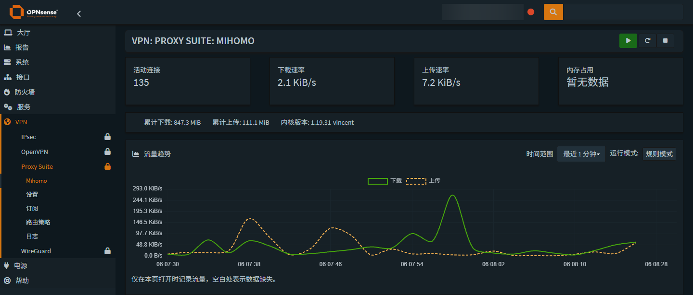
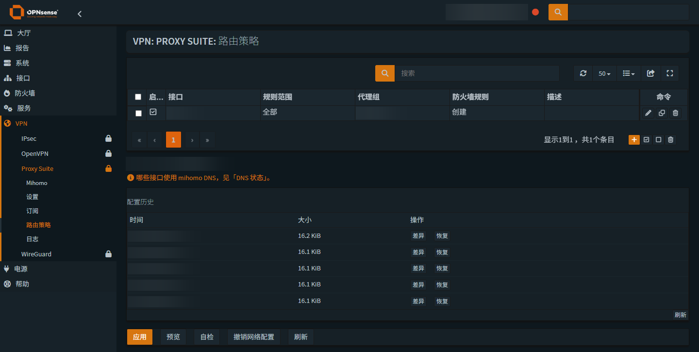
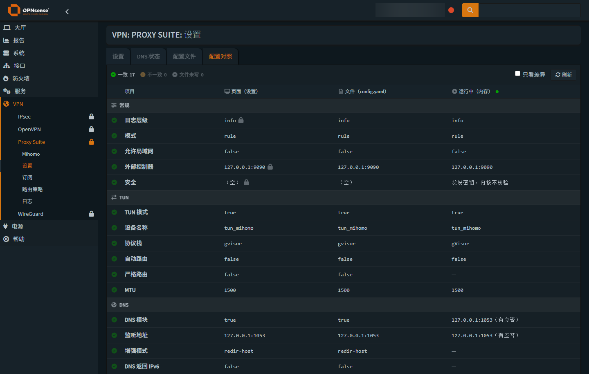

# os-mihomo

**在 OPNsense 中原生管理 Mihomo。**

[](https://github.com/Thweki/os-mihomo/actions/workflows/ci.yml)
[English](README.US.md)

os-mihomo 将流量监控、代理分组、配置管理、订阅更新和路由策略整合到 OPNsense WebGUI。页面使用 OPNsense 原生 MVC、表单和表格，继承当前系统主题，并提供简体中文与英文界面。

浏览器通过 OPNsense 的插件 API 访问 Mihomo，由服务端通过回环地址连接内核控制器并携带认证密钥。无需开放控制器端口给浏览器，也不嵌入第三方面板或另起 Web 服务。

## 功能一览

安装后从 **VPN → Proxy Suite** 进入各页面。

| 页面 | 功能 |
| --- | --- |
| Mihomo 概览 | 实时速率、累计流量、活动连接、进程内存、当前转发、代理分组与延迟测试、运行模式与服务状态 |
| 设置 | 原生配置表单、写入锁、改动预览与丢弃、重新应用、高级选项、YAML 编辑与校验、配置对照、DNS 状态 |
| 路由策略 | 查看当前转发与规则详情；按接口配置策略、预览变更、配置网络绑定、查看与恢复配置历史 |
| 订阅 | 提交更新任务，查看任务状态、最近成功时间、退出码和执行日志 |
| 日志 | 筛选已载入的日志、暂停自动刷新、切换来源与行数、下载或清空日志 |

流量图支持最近 **1 分钟、5 分钟、15 分钟、1 小时**，数值保留一位小数。历史随概览页打开而采集，缺失样本显示为断点，不提供后台长期流量存储。图表颜色跟随当前 OPNsense 主题，无独立主题开关。

“当前转发”只读展示已加载的 PF 规则，并保留地址族、方向、端口限制与例外条件。规则顺序和内核策略仍会影响实际流量；DNS 路径反映配置，是否可用应以客户端查询为准。进程内存显示内核的 RSS。



本文截图来自实际界面，敏感信息已通过本地脚本模糊处理。截图中的配色继承系统主题，配置值仅用于展示界面。

## 运行环境

| 项目 | 当前版本 / 目标 |
| --- | --- |
| 插件 | `1.1.0` |
| OPNsense | `26.7` 系列 |
| 构建环境 | FreeBSD `15.1`，`amd64` |
| Mihomo 内核 | `1.19.31-vincent` |
| 包依赖 | `curl`、`jq` |

其他系统版本与架构尚需单独验证。内核和 Geo 数据的来源、固定版本及校验和记录在 [内核来源](packaging/freebsd/binary-source.json)与 [Geo 数据来源](packaging/freebsd/geodata-source.json)中。

## 安装

### 使用构建产物

1. 打开 [GitHub Actions](https://github.com/Thweki/os-mihomo/actions/workflows/ci.yml)，选择一次成功的构建，下载 `os-mihomo-freebsd15-amd64` 产物。
2. 解压后，将 `os-mihomo.pkg`、`os-mihomo-repository.tar.gz` 和 `SHA256SUMS` 放到目标系统的同一目录。产物还附带 `package-files.txt` 文件清单。
3. 在该目录以管理员身份校验并安装：

```sh
# 校验插件包与仓库压缩包；任一校验失败即停止。
while read -r expected file; do
    sha256 -c "$expected" "$file" || exit 1
done < SHA256SUMS

pkg install -y curl jq
pkg add os-mihomo.pkg

# 让 OPNsense 加载新增的插件后端动作。
service configd restart
```

**新装默认关闭开机自启，安装过程不会启动 Mihomo。** 安装钩子不会自动创建接口、防火墙规则或修改路由、DNS。配置以 `.sample` 文件随包分发，仅在对应运行文件不存在时复制；已有配置与自启设置会保留。

随包 YAML 含示例节点与示例凭据，不能直接作为可用代理配置。启动前请完成下方的首次配置。

### 通过插件管理器分发

维护者可将产物中的仓库压缩包解压到静态文件服务器，保留 ABI 子目录。修改其中的 `os-mihomo.conf`，让 `url` 指向包含 `meta.conf` 的目录，再将配置放入目标系统的 `/usr/local/etc/pkg/repos/`。

刷新仓库元数据后，可从 **系统 → 固件 → 插件** 管理 `os-mihomo`。仓库模板中的 URL 需要自行填写；本项目的构建流程只生成仓库文件，不提供托管的软件源。详见 [CI/CD 说明](docs/ci-cd.md)。

## 首次配置

1. **准备配置。** 在设置页编辑有效的 Mihomo YAML，或填写订阅信息后到订阅页执行更新。检查节点、代理组、控制器密钥及监听地址，控制器保持回环监听即可供 WebUI 使用。
2. **明确哪些值由页面管理。** YAML 对应的表单项带有锁图标：锁定表示应用时保留文件中的值，解锁表示允许页面写入。固定项不可编辑。开机自启和订阅等插件设置独立于这些 YAML 写入锁。
3. **校验后再启动。** 使用配置校验和配置对照检查文件，确认 TUN、自动路由和 DNS 选项符合预期，再通过服务控制按钮启动。服务启停与开机自启是两个独立操作。
4. **按需配置路由策略。** 添加接口与代理组，先预览，再应用。选择由插件创建防火墙规则时，会涉及 OPNsense 接口、网关与防火墙配置；选择手动管理时，需要自行确保流量到达 Mihomo。
5. **核对实际运行情况。** 在概览、活动连接、DNS 状态和日志中确认结果。页面值、文件值和内核运行值可能不同，可在“配置对照”中查看。

网络策略生效后，相关流量可能依赖 Mihomo 持续运行。停止服务或卸载插件前，应先解除依赖它的策略。



## 配置与维护

### 表单、YAML 与运行状态

表单保存的设置、磁盘上的 YAML 和内核运行中的配置分别管理。设置页“应用”会将允许写入的字段落到文件，并同步插件设置；保存文件不代表运行中的内核已经载入新值。需要重新载入时，应显式执行相应重启操作。

高级 YAML 编辑器默认只读。点击编辑后才能修改，保存前可查看改动；服务端校验通过并备份旧文件后才会替换配置。DNS 状态和配置对照属于只读视图。



### 写入一致性与权限

设置、YAML、策略、订阅安装和恢复共用文件写入锁。页面携带读取时的 SHA-256 基线；文件或模型发生变化时，旧页面提交会被拒绝，请重新载入并检查差异。设置版本也包含 OPNsense 配置文件，因此其他管理页面的保存可能触发重新载入。规则的启用/删除仍是针对当前 UUID 的即时操作。

新内容先在目标文件系统的唯一暂存文件中校验，再保存真正的旧内容并逐文件原子替换。设置的 YAML、订阅 env、自启文件，以及策略的 YAML/模板分别成组提交；可捕获的写入错误会恢复已替换的文件。配置及备份权限为 `0600`，备份名为 `<原文件>.bak.<时间>_<随机后缀>`，每个文件保留最近 20 份。配置历史可校验并恢复 YAML，恢复前也会备份当前文件。跨文件提交不保证断电或进程被强制终止时的整体原子性；此时应根据备份核对两个目标。

动作返回 `state`：`unchanged`（未变化）、`completed`（完成）、`accepted`（任务已接受）、`failed`（失败）或 `partial`（部分完成）。Cron 和服务重载不属于文件事务；失败会显示部分完成，Cron 重载保留待重试标记。已接受重启不等于服务已正常运行，请检查状态。原配置内容只会出现在有配置权限的编辑/历史接口中；日志展示会隐藏 URL 和常见密钥字段。

OPNsense 权限新增 `Mihomo (view)`、`Mihomo (operate)`、`Mihomo (configure)`：分别用于查看状态与脱敏日志、运行控制、配置及凭据管理。按需组合授予；原 `Mihomo` 全权限授权保持兼容。原生设置模型保存/导入仍保留既有的 full-admin 限制。只读用户无法选择节点、切换模式、关闭连接或执行写入。查看权限不授予原始 YAML、订阅凭据和备份内容访问。

### 订阅更新

订阅更新会根据订阅模板重新生成 `config.yaml`，因此可能覆盖手工编辑的内容。需要持续保留的配置应同时体现在订阅模板中。下载和校验失败会保留原配置；下载期间发生配置、模板或 env 变更时也会拒绝覆盖。WebUI 默认只更新文件，是否重启由操作时选择；CLI/定时订阅保留原有重启行为。提交更新任务后，请查看轻量任务状态与订阅日志确认结果。

兼容默认转换器为 `https://subconverters.com/sub`。使用转换器时，路由器会将**完整订阅 URL（包括其中的令牌）**发送给该服务，由其获取并转换节点数据；控制器密钥仅在本机合成配置时写入，不作为转换请求参数。转换器属于第三方信任边界，插件日志不记录完整请求或密钥。在 root 管理的 `/usr/local/etc/mihomo/sub/env` 中配置以下变量之一（文件格式为 shell 单引号赋值，保留 `0600`）：

```sh
# 提供商直接返回含 proxies 的 Clash YAML：不经过转换器。
MIHOMO_CONVERTER_URL='direct'
# 或使用自己控制/信任的 HTTPS 转换器：
# MIHOMO_CONVERTER_URL='https://converter.example.com/sub'
```

`direct` 模式仍从提供商下载订阅，只提取节点并按本地模板生成配置，不直接采用订阅中的规则或代理组。

| 文件 | 用途 |
| --- | --- |
| `/usr/local/etc/mihomo/config.yaml` | Mihomo 运行配置文件 |
| `/usr/local/etc/mihomo/sub/template_config.yaml` | 订阅生成模板 |
| `/usr/local/etc/mihomo/sub/env` | 订阅参数与凭据 |
| `/etc/rc.conf.d/mihomo` | 开机自启设置 |
| `/var/log/mihomo.log` | 内核日志 |
| `/var/log/mihomo_sub.log` | 订阅任务日志 |

### 升级、迁移与卸载

升级前备份 OPNsense 配置及上述 Mihomo 配置文件。从其他来源的同名插件迁移时，还需检查原包的卸载钩子，避免其清理操作影响现有网络设置。

本版本卸载时保留用户配置与网络设置，不自动停止服务。请先解除网络策略依赖、停止 Mihomo，再卸载插件。保留的配置可供后续恢复使用。

### 常见问题

- **页面打开了，但没有运行数据：** 检查服务是否运行、控制器是否可通过回环地址访问，以及当前文件中的端口与密钥是否和运行实例一致。
- **改了表单，文件却没变化：** 检查该字段是否仍处于锁定状态；只有解锁的 YAML 字段会由表单写入。
- **文件更新了，运行值仍是旧值：** 配置对照会显示这一差异；确认变更后重新载入服务配置。
- **安装后后端动作不可用：** 确认已执行 `service configd restart`，随后刷新 WebGUI。

## 开发与构建

仓库根目录就是插件树，`src/` 镜像目标系统的安装路径。

| 目录 | 内容 |
| --- | --- |
| `src/usr/local/opnsense/mvc/app/` | MVC 模型、控制器与 Volt 页面 |
| `src/usr/local/opnsense/scripts/mihomo/` | 插件后端脚本 |
| `src/usr/local/opnsense/service/conf/actions.d/` | configd 动作定义 |
| `packaging/freebsd/` | 包元数据、安装钩子和资产来源 |
| `locales/` | gettext 模板与译文 |
| `tests/`、`tools/` | 回归检查与维护工具 |

页面入口为 `/ui/mihomo/*`，API 入口为 `/api/mihomo/*`。

源码检查需要 Python 3、Node.js、PHP 和 POSIX shell：

```sh
python3 tools/check_publication.py
python3 tools/validate.py
```

在 FreeBSD 15 amd64 上构建，需要 `make`、`pkg`、`tar`、`xz`、`sha256`、`python3`、`git`，以及 `fetch` 或 `curl`：

```sh
make package   # 生成 dist/os-mihomo.pkg
make repo      # 生成 dist/repo/<ABI>/
```

这两个命令只构建产物，不安装插件或执行包钩子。CI 在隔离的 FreeBSD 环境中构建和检查包；匹配版本号的 `v<version>` 标签触发 Release 草稿。完整流程见 [CI/CD 说明](docs/ci-cd.md)。

构建以 `SOURCE_DATE_EPOCH`（默认提交时间）固定包时间戳与归档顺序，CI 对两次独立构建逐字节比较。发布包含记录源码与工具链的 `build-info.json`；新的标签流程生成 GitHub 构建来源证明，可用 `gh attestation verify os-mihomo.pkg --repo Thweki/os-mihomo` 验证。已有旧版本不会自动获得证明。软件源支持 `REPO_SIGNING_KEY` / `REPO_PUBLIC_KEY` 签名及 `REQUIRE_SIGNED=yes` 防止未签名回退；生产私钥、公钥信任分发和 HTTPS 托管仍需自行配置，详见 CI/CD 文档。

### 翻译

参照 `locales/os-mihomo.pot` 编辑 `locales/<locale>.po`，然后生成并检查翻译文件：

```sh
python3 tools/build_locales.py
python3 tools/build_locales.py --check
```

提交译文时一并提交生成的翻译目录文件。插件使用独立 gettext 域，不修改 OPNsense 系统翻译；缺少译文时回退到系统翻译或英文。

## 来源与致谢

本项目基于 [Opnwall/OPNsense-repo](https://github.com/Opnwall/OPNsense-repo) 中 `os-mihomo 1.0.4` 的插件资产与打包基础独立开发原生 WebUI。

- [MetaCubeX/mihomo](https://github.com/MetaCubeX/mihomo)：Mihomo 内核。
- [Vincent-Loeng/clash-meta](https://github.com/Vincent-Loeng/clash-meta)：本项目使用的 FreeBSD 内核构建。

各源文件及第三方组件保留其原始版权和许可声明。
