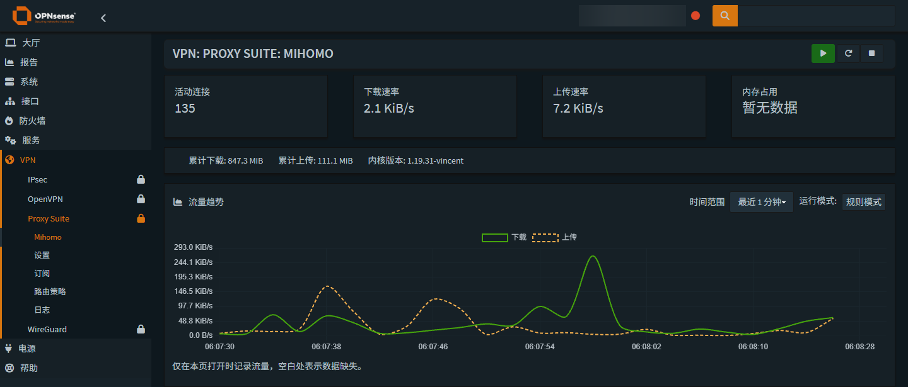

# os-mihomo

[English](README.US.md) · [正式版本](https://github.com/Thweki/os-mihomo/releases) · [问题反馈](https://github.com/Thweki/os-mihomo/issues)

os-mihomo 是一个第三方 OPNsense 插件。它把 Mihomo 的代理分组、连接、流量和日志放进 OPNsense WebGUI，也提供配置、订阅更新和按接口设置路由策略的入口。安装后打开 **VPN → Proxy Suite → Mihomo**。

## 安装

适用目标为 **OPNsense 26.7 系列，FreeBSD 15 amd64**。添加项目的签名软件源后，可以在 **系统 → 固件** 安装和更新 `os-mihomo`。也可以下载并验证正式 Release 的 `.pkg` 后单独安装。[安装、升级与卸载](docs/install.md)

全新安装后 Mihomo 保持停止，开机自启默认关闭。用自己的配置完成校验后再启动。如需接管客户端流量，请另行确认 TUN、路由和 DNS 的影响。[首次配置与日常使用](docs/usage.md#首次配置)

## 更多文档

- 代理测速、连接、订阅和配置对照。[日常使用和排障](docs/usage.md)
- 从源码构建、验证发布包或自行分发。[构建、CI 与签名软件源](docs/ci-cd.md)
- 查看界面如何区分已保存的配置和防火墙实际加载的规则。[路由状态的判定与测试](docs/audit-b7.md)

本项目基于 Opnwall 的插件资产开发，使用 MetaCubeX/mihomo 和 Vincent-Loeng 提供的 FreeBSD 内核构建。[原始插件](https://github.com/Opnwall/OPNsense-repo) · [内核源码](https://github.com/MetaCubeX/mihomo) · [FreeBSD 内核构建](https://github.com/Vincent-Loeng/clash-meta)
