# os-mihomo WebUI 二次开发 — 交付报告

> **一句话**：把上游 `Opnwall/OPNsense-repo:src/os-mihomo`（1.0.4，纯 legacy 过程式页面）的 WebUI
> **重写为 OPNsense 原生 MVC 界面**并实机安装到 `192.168.1.1`，
> 全程未触碰防火墙 / NAT / 路由 / DNS 配置，服务保持未启用状态。
>
> - 目标设备：OPNsense 26.7.7 (amd64) / FreeBSD 15.1-RELEASE-p4 / PHP 8.5.11
> - 本次版本：`os-mihomo 1.1.0`（上游基线 1.0.4）
> - 仓库：本目录（根目录即插件树，3 次提交，可逐级回滚）
> - 全部截图均为 **在真实设备上通过浏览器实测** 所得（见 `docs/screenshots/`）

---

## 目录

1. [交付内容速览](#1-交付内容速览)
2. [上游 WebUI 的问题（附证据）](#2-上游-webui-的问题附证据)
3. [目标架构](#3-目标架构)
4. [实现清单](#4-实现清单)
5. [界面实测（真实截图）](#5-界面实测真实截图)
6. [与 OPNsense 原生风格的一致性](#6-与-opnsense-原生风格的一致性)
7. [安全边界与「零网络改动」证明](#7-安全边界与零网络改动证明)
8. [验证矩阵](#8-验证矩阵)
9. [部署 / 回滚 / 日常运维](#9-部署--回滚--日常运维)
10. [事故记录](#10-事故记录)
11. [已知限制与后续建议](#11-已知限制与后续建议)
13. [P8 收尾：打包 / 回滚演练 / 中文化](#13-p8-收尾打包--回滚演练--中文化)
14. [路由策略（P12-1）](#15-路由策略p12-1按接口源分流原生表格--真实节点实测)
20. [附录：命令速查](#20-附录命令速查)
21. [P15：界面细节修复 + 配置说明文档](#21-p15界面细节修复--配置说明文档)
22. [P17：修好「应用」报错 + IPv6 选项 + 只写入我改过的项](#22-p17修好应用报错--ipv6-选项--只写入我改过的项)
23. [P18：修好「策略只能加/删，不能改」+ 设置项「不修改」](#23-p18修好策略只能加删不能改--设置项不修改)

---

## 1. 交付内容速览

| 项目 | 内容 |
|---|---|
| 页面 | `VPN → Proxy Suite →` **Mihomo / Settings / Subscription / Log File**（4 个原生 MVC 页面） |
| 路由 | `/ui/mihomo`、`/ui/mihomo/settings`、`/ui/mihomo/subscription`、`/ui/mihomo/log` |
| 接口 | `/api/mihomo/{service,settings,dashboard,subscription,log}/*`（共 20 个端点） |
| 仪表盘 | 服务状态、实时速率曲线、累计流量、内存/版本、**代理分组与节点切换/测速**、**活动连接表**（可关闭单条/全部）、运行模式切换 |
| 设置 | 原生表单（服务/控制器/TUN/DNS/订阅）+ 原始 YAML 编辑器（写盘前 `mihomo -t` 校验 + 自动备份） |
| 订阅 | 订阅地址/密钥、一键更新、**默认不自动重启服务**（安全默认）、实时日志 |
| 日志 | 内核日志 / 订阅日志双来源，支持行数、刷新、下载、清空（经 configd 读 root 文件，无需放宽权限） |
| 兼容 | 旧地址 `/mihomo.php` → 302 `/ui/mihomo`（保留 ACL 保护） |
| 安全体检 | 启动前显式列出 TUN 接管、占位节点、控制器暴露、DNS 劫持等风险 |
| 服务控件 | 页面标题栏原生 start/stop/restart 按钮（`updateServiceControlUI`） |
| 内核资产 | 沿用上游 mihomo 内核（1.19.31-vincent）、rc.d、订阅脚本、configd 动作 |
| 安装包 | `os-mihomo-1.1.0.pkg`（25.7 MiB，sha256 `2faa09a9…`），native ABI，已是**标准 OPNsense 插件包**格式，可被自带插件管理器管理 |
| 中文化 | 146 条 zh_CN 词条，四个页面 + 表单标签 + 帮助 + 风险详情全中文 |

---

## 2. 上游 WebUI 的问题（附证据）

上游 1.0.4 的 WebUI 是 4 个过程式页面（`/usr/local/www/mihomo*.php`），实测存在以下问题。
下表右列均为本次在设备上**实测/读源码**得到的结论。

| # | 问题 | 证据 |
|---|---|---|
| 1 | 不属于 MVC，无控制器/视图/模型 | 上游源码只有 `www/*.php`，无 `controllers` / `views`；菜单直接指 `/mihomo.php` |
| 2 | 不用框架的服务控件 | 页面用 `fetch('/mihomo.php?ajax=status')` + `setInterval(2000)` 自建轮询，而不是 `updateServiceControlUI()` |
| 3 | 自建 CSRF，与框架机制并存 | 每个页面各自维护 `$_SESSION[..._csrf_token]` |
| 4 | 自实现 i18n，靠正则解析 `/conf/config.xml` 猜语言 | `proxy_lang()` 正则读 config.xml，忽略 `lang._()` / gettext |
| 5 | **「WebUI」实际依赖另起 HTTP 服务** | 上游 README：「默认配置会开启 Clash API，可通过 `http://LAN_IP:9090/ui` 访问仪表盘」；`config.yaml` 里的 `external-ui-url` 还会在运行时从 GitHub 拉取第三方面板 zashboard |
| 6 | 控制器对外暴露 | `external-controller: 0.0.0.0:9090`，且 `secret` 是随包占位值 `CHANGE_ME` |
| 7 | 启动无任何风险提示 | 默认 `tun.auto-route: true` + 占位节点 `88.88.88.88`，启动即接管全局路由，界面不提示 |
| 8 | 订阅更新会无条件重启服务 | `sub.sh` 结尾 `MIHOMO_SERVICE_CMD="service mihomo restart"`，即使新配置有问题也会触发重启 |

> **一处重要更正（记录在案）**：本次实现过程中实测发现，**本机 WebGUI 的 PHP 其实是以 root 运行的**
> —— lighttpd（root）通过 `mod_fastcgi` 拉起 `php-cgi`（`ps` 显示 10 个 `php-cgi` 全部是 root；
> `php-fpm.d/www.conf` 里的 `user = www` 并不服务于 WebGUI）。
> 因此上游页面里那些 `exec()` / `fopen()` / `is_writable()` 判断**是可行的**，
> 上游并不存在"保存配置必然失败/日志必然空白"的问题（这一点在初稿中判断有误，已更正）。
>
> 既然如此，为什么本次仍把特权写入统一改走 **configd**？三个理由：
> 1. **可审计**：每个动作都会进 syslog，谁在什么时候改了配置一查便知；
> 2. **少一处 RCE 面**：PHP 里不再拼接执行 shell 命令，也不在 Web 进程里做文件属主判断；
> 3. **可测试**：这些脚本能脱离 Web 环境单独以 root 运行并做回归（本次就是这么做的）。

---

## 3. 目标架构

```
   浏览器（已登录的 OPNsense WebGUI 会话，受 ACL 保护）
        │
        │  /ui/mihomo/*        Volt 视图（Bootstrap 3 + opnsense 主题）
        │  /api/mihomo/*       OPNsense MVC API（自动 CSRF / ACL / 审计）
        ▼
   php-fpm (用户 www) ── 只读直读 config.yaml（0644）
        │
        ├── configd (root) ◄── 特权动作
        │      └── /usr/local/opnsense/scripts/mihomo/{config_apply,env,logtail,logclear,service_enable,subscription_run}
        │
        └── loopback HTTP 127.0.0.1:9090 ◄── mihomo external controller
               GET  /version /configs /proxies /connections
               PUT  /proxies/{name}        选节点
               GET  /proxies/{name}/delay  测延迟
               PATCH /configs              切模式
               DELETE /connections[/{id}]  断连接
```

**三条硬约束**（也是验收标准）：

1. 所有页面由 **OPNsense 自身 MVC** 渲染 —— 无 iframe、无第三方面板（zashboard/yacd/metacubed）。
2. 浏览器**永不**直连 `:9090`；所有实时数据由 **服务端 PHP** 经 loopback + Bearer secret 取回。
3. 特权操作（写配置、写 env、读日志）**全部经 configd 以 root 执行**，不给 Web 进程放宽任何文件权限。

---

## 4. 实现清单

### 4.1 新增文件（安装路径镜像）

```
src/usr/local/opnsense/mvc/app/
├── models/OPNsense/Mihomo/
│   ├── Mihomo.php / Mihomo.xml         设置模型（挂载 //OPNsense/mihomo）
│   ├── Config.php                      config.yaml 扫描 + 嵌套键补丁 + 临时文件
│   ├── Controller.php                  mihomo REST 客户端（loopback）
│   ├── Safety.php                      安全体检规则集
│   ├── Logs.php                        日志读取（经 configd）
│   ├── Subscription.php                订阅 env / 执行 / 日志
│   ├── RequestParamsTrait.php          参数读取（POST/JSON/GET 兼容）
│   ├── ACL/ACL.xml                     ui/mihomo/*、api/mihomo/*、旧页面
│   └── Menu/Menu.xml                   VPN → Proxy Suite → 4 项
├── controllers/OPNsense/Mihomo/
│   ├── Index/Settings/Subscription/LogController.php     4 个页面控制器
│   ├── forms/settings.xml                                原生表单定义
│   └── Api/{Dashboard,Service,Settings,Subscription,Log}Controller.php
└── views/OPNsense/Mihomo/{index,settings,subscription,log}.volt

src/usr/local/opnsense/scripts/mihomo/
├── config_apply.php      校验( mihomo -t )→ 备份 → 原子安装（root）
├── env.php               订阅 env 读写（root，0600）
├── logtail.php           日志尾部（root）
├── logclear.php          日志清空（root）
├── service_enable.php    写 /etc/rc.conf.d/mihomo
└── subscription_run.sh   订阅执行器（默认不重启服务）

src/usr/local/www/mihomo{,_sub,_logs,_sub_log}.php    → 302 跳转页
src/usr/local/opnsense/service/conf/actions.d/actions_mihomo.conf   新增 9 个动作
```

### 4.2 API 一览

| 端点 | 方法 | 说明 |
|---|---|---|
| `/api/mihomo/service/status` | GET | 状态（`running`/`stopped`/`disabled`）+ 控件文案 |
| `/api/mihomo/service/{start,stop,restart}` | POST | 服务控制（configd → rc.d/mihomo） |
| `/api/mihomo/service/safety` | GET/POST | 安全体检（可选 `validate=1` 触发语法校验） |
| `/api/mihomo/settings/get` `set` | GET/POST | 模型读写（原生 `ApiMutableModelControllerBase`） |
| `/api/mihomo/settings/apply` | POST | 模型 → config.yaml + rc.conf.d + env（带校验/备份） |
| `/api/mihomo/settings/import` | POST | 现状 → 模型（首次使用/手工改过配置后同步） |
| `/api/mihomo/settings/config_{get,set,validate,test}` | 混合 | 原始 YAML 读/写/校验 |
| `/api/mihomo/dashboard/{overview,proxies,connections}` | GET | 概览 / 代理分组 / 连接表（服务端分页搜索） |
| `/api/mihomo/dashboard/{select_proxy,test_delay,set_mode,close_connection}` | POST | 选节点 / 测速 / 切模式 / 断连接 |
| `/api/mihomo/subscription/{get,save,run,log,clear_log}` | 混合 | 订阅管理 |
| `/api/mihomo/log/{tail,clear}` | 混合 | 日志 |

### 4.3 config.yaml 的「外科手术式」修改

设置页的 Apply 不是"整文件覆盖"，而是严格的最小改动流程：

1. 读入现有 `config.yaml`；
2. **逐键比较**：目标值与文件现有值等价的键 **一个字节都不动**（保留原有注释、引号风格、缩进）；
3. 需要改动的键，只替换该行的值，并**保留该行的行尾注释**；
4. 只触及受管键（`log-level`、`mode`、`allow-lan`、`external-controller`、`secret`、`tun.*`、`dns.*`），
   `proxies` / `proxy-groups` / `rules` / 其它注释完全不动；
5. 写入 `/tmp/mihomo-XXXXXX`（0600，随机名）；
6. `configd` 以 root 运行 `mihomo -t` 校验 → **不通过就一个字都不写**；
7. 通过后备份 `config.yaml.bak.YYYYmmdd_HHMMSS`（保留最近 20 份），再 `install -o root -g wheel` 原子替换。

实测效果（Apply 后的完整 diff，配置里原本有大量中文注释与代理规则）：

```diff
-external-controller: 0.0.0.0:9090
+external-controller: 127.0.0.1:9090
```

就这一行。其余 233 行（含 `log-level: info #在调试结果后…`、`secret: "CHANGE_ME"`、4 个代理节点、19 条规则）**逐字节未变**。

补丁器有 **35 项回归测试**（`tests/test_patch.php`），在目标机上对真实 `config.yaml` 跑通 **0 失败**，
覆盖：幂等性、值相同零改动、行尾注释保留、CRLF、特殊值引号、嵌套块新增、proxies/rules 完整性、
以及"补丁结果必须能通过 `mihomo -t`"。

---

## 5. 界面实测（真实截图）

> 截图采集方式：`agent-browser`（真实 Chromium）登录 `https://192.168.1.1` 后逐页截图。
> 仪表盘的数据来自一个**隔离 demo 实例**（无 TUN、无 DNS 劫持、仅监听 127.0.0.1），
> 目的只是让曲线/连接表/代理组有真实内容；该实例已停止，见 §7。

### 5.1 概览 / 仪表盘

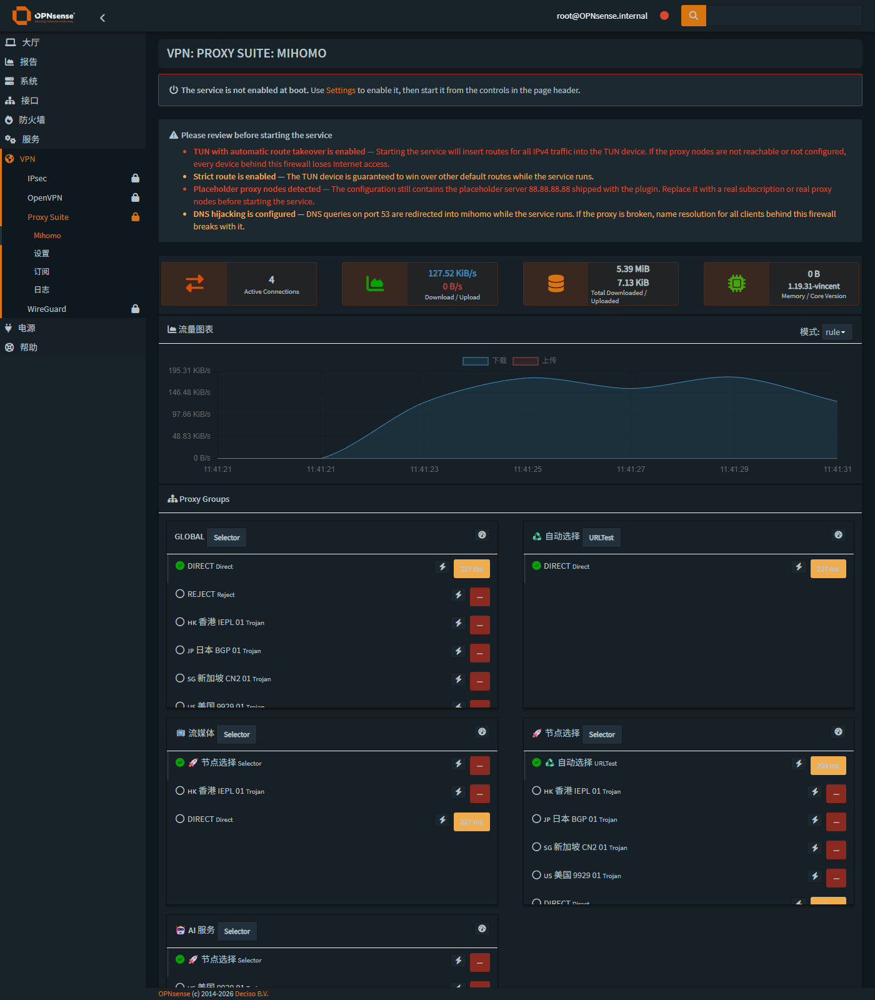

自上而下：

1. **服务未启用提示**（橙）——默认不 enable，避免重启后自动接管路由；
2. **启动前安全体检**（红）——逐条列出 TUN 自动接管、strict-route、占位节点、控制器暴露、DNS 劫持；
3. **四个原生统计卡**——活动连接、实时上下行、累计流量、内存/内核版本（图标徽章样式与核心页面一致）；
4. **流量曲线**——2 秒采样，实时速率；
5. **Proxy Groups**——每个分组一张卡片：类型徽章、整组测速、成员列表（已选中的打绿勾）、
   单节点测速按钮、延迟徽章（<200ms 绿 / <500ms 黄 / 超时红）；
6. **Active Connections**——标准 `UIBootgrid`：搜索、排序、分页、"关闭全部"，每行可单独断开。

不运行服务时（交付后的默认状态）：

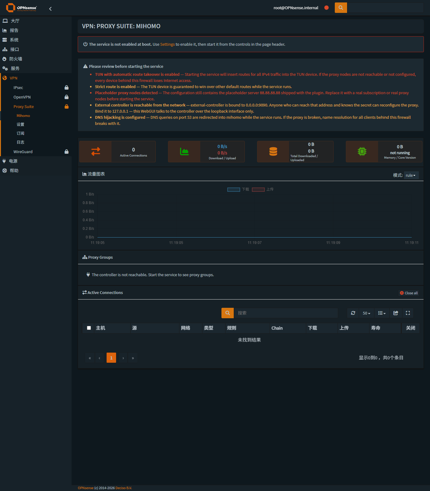

### 5.2 菜单集成

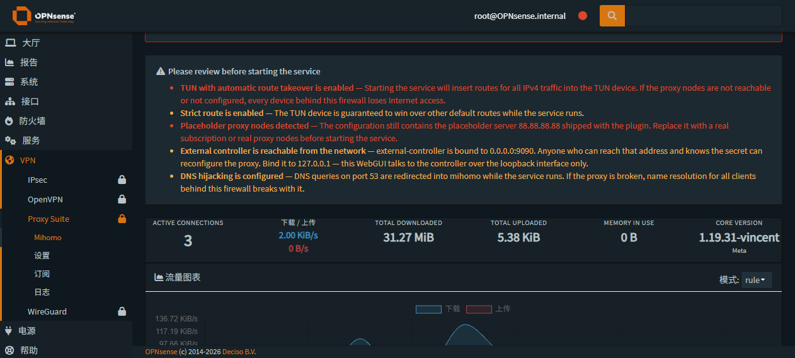

`VPN → Proxy Suite → Mihomo / 设置 / 订阅 / 日志`，与 `IPsec`/`OpenVPN`/`WireGuard` 同级，
带主题高亮与锁图标（继承 `ProxySuite` 的 `fa-lock`），标题栏显示完整面包屑
`VPN: PROXY SUITE: MIHOMO`。

### 5.3 设置

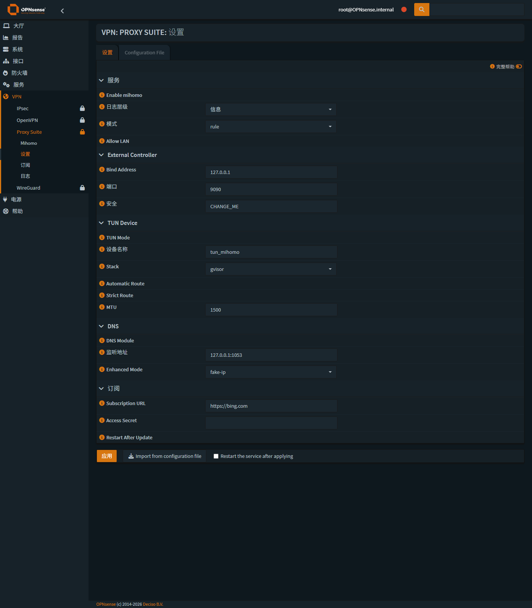

原生 `base_form` 渲染：分节折叠、开关、下拉、文本框全部由模型驱动，
页脚是 Apply / Import from configuration file / Restart the service after applying。

「Configuration File」标签页提供原始 YAML 编辑：

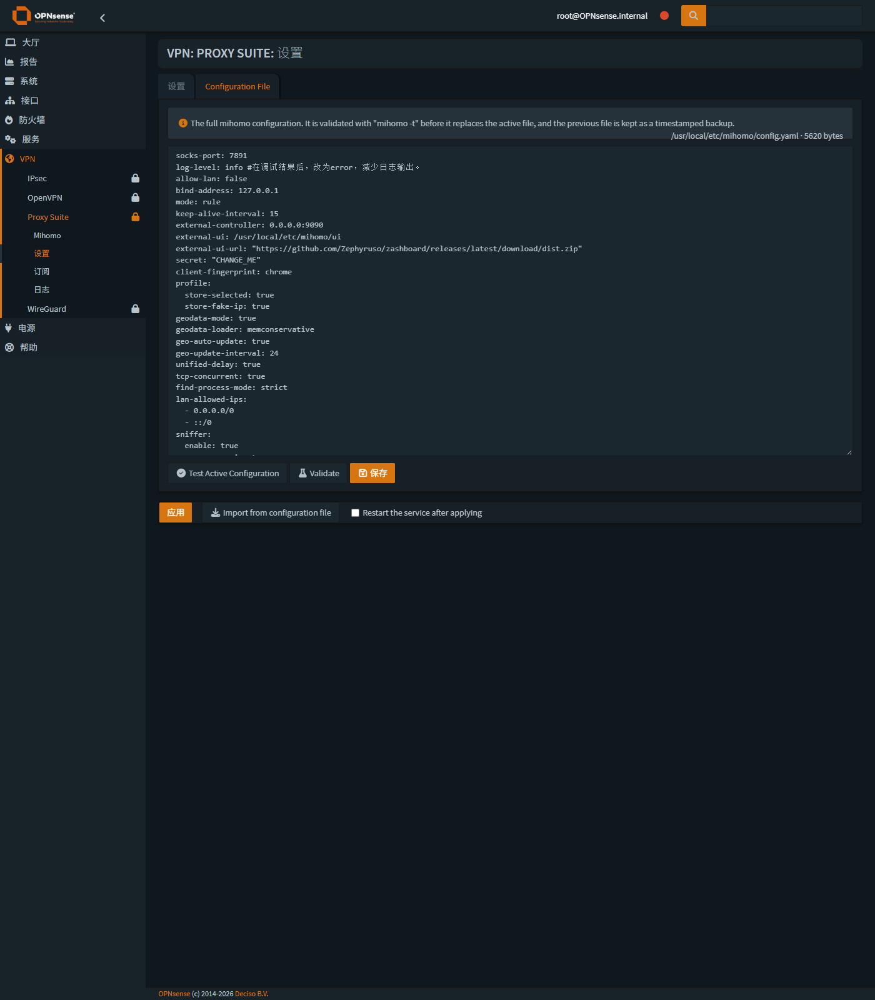

### 5.4 订阅

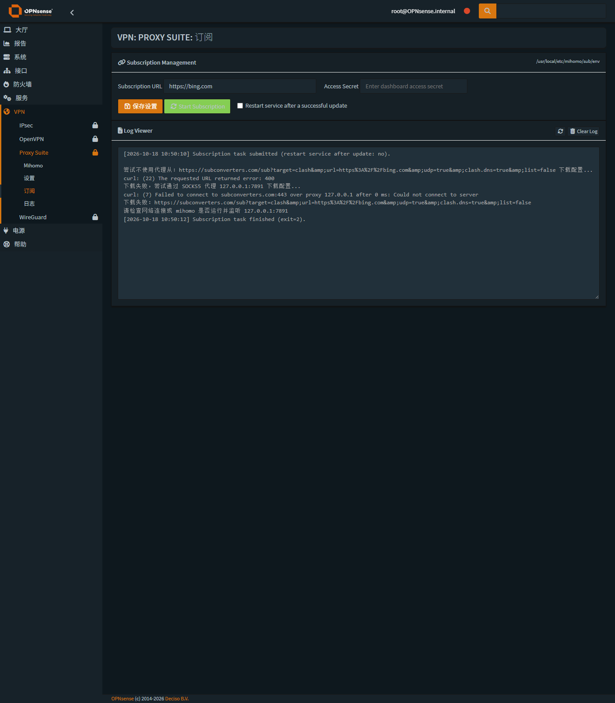

上图是**真实执行过一次订阅更新**后的日志（订阅地址是随包占位的 `https://bing.com`，
所以下载失败）。请注意日志首尾：

```
[2026-10-18 10:50:10] Subscription task submitted (restart service after update: no).
...
[2026-10-18 10:50:12] Subscription task finished (exit=2).
```

**任务失败但配置文件与运行中的服务毫发无伤** —— 这正是上游 `sub.sh` 结尾写死
`service mihomo restart` 所带来的风险，本次通过 `MIHOMO_SERVICE_CMD` 覆写为
「不重启」，并把"更新后重启"做成显式勾选项（默认关闭）。

### 5.5 日志

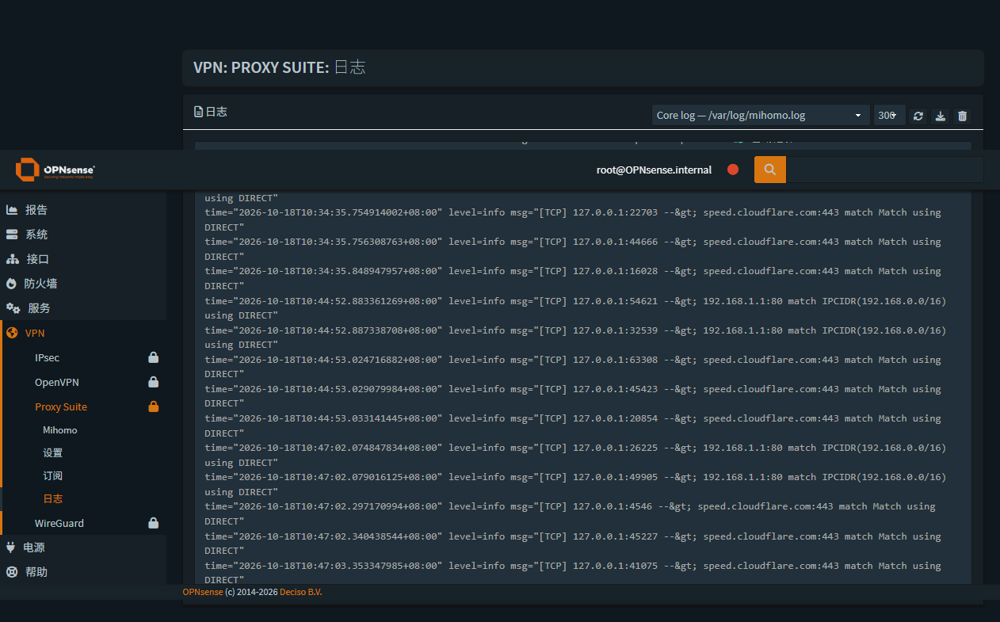

内核日志（真实 mihomo 输出，含规则匹配明细）。切换数据源可看订阅日志：

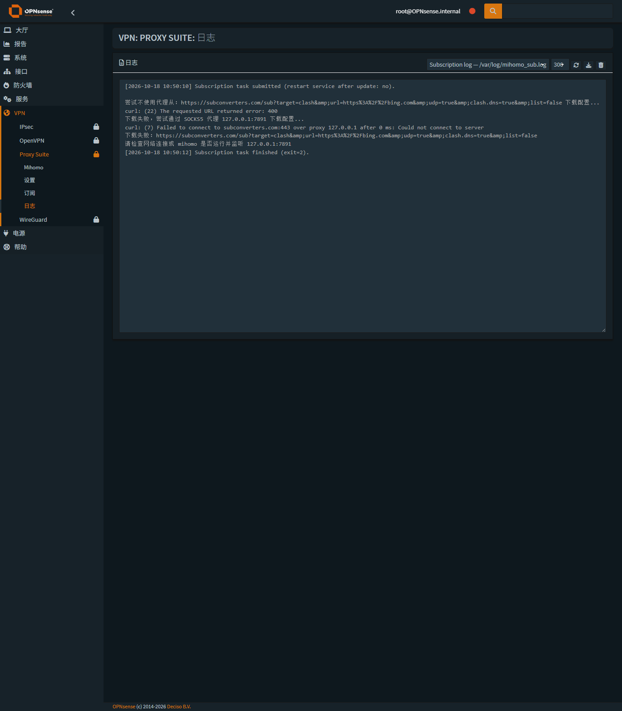

> 这两处日志文件属主是 root（`0640`），页面能读是因为统一经 configd 取回，
> 与核心插件（Monit / Unbound 的日志页）走的是同一条可审计路径。

### 5.6 服务控件（临时演示）

把模型开关临时打开（**未修改 rc.conf.d、未启动服务**）后，页面标题栏出现原生服务控件：

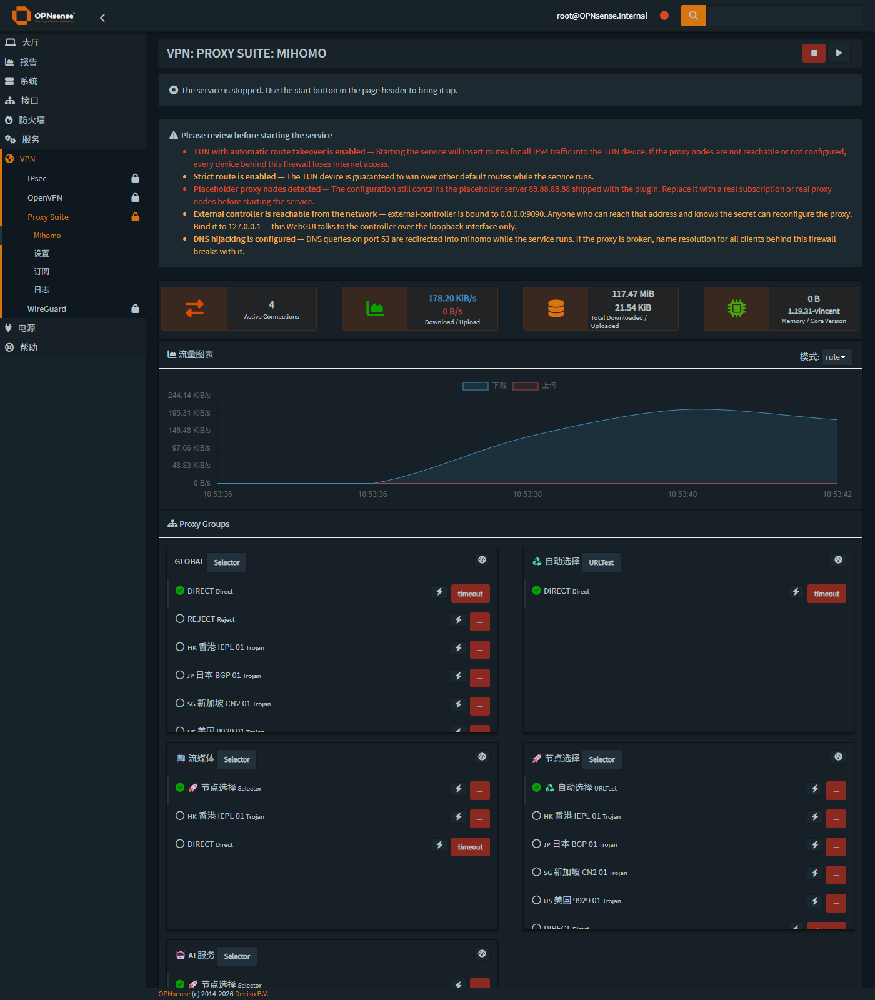

红色方块 = 服务已停止，绿色 ▶ = 启动按钮（悬停提示文案来自 API 的 `widget.caption_*`）。
演示后已还原为「未启用」。

---

## 6. 与 OPNsense 原生风格的一致性

对照同一个设备上的核心页面：

| 核心页面 | 本次交付 |
|---|---|
| 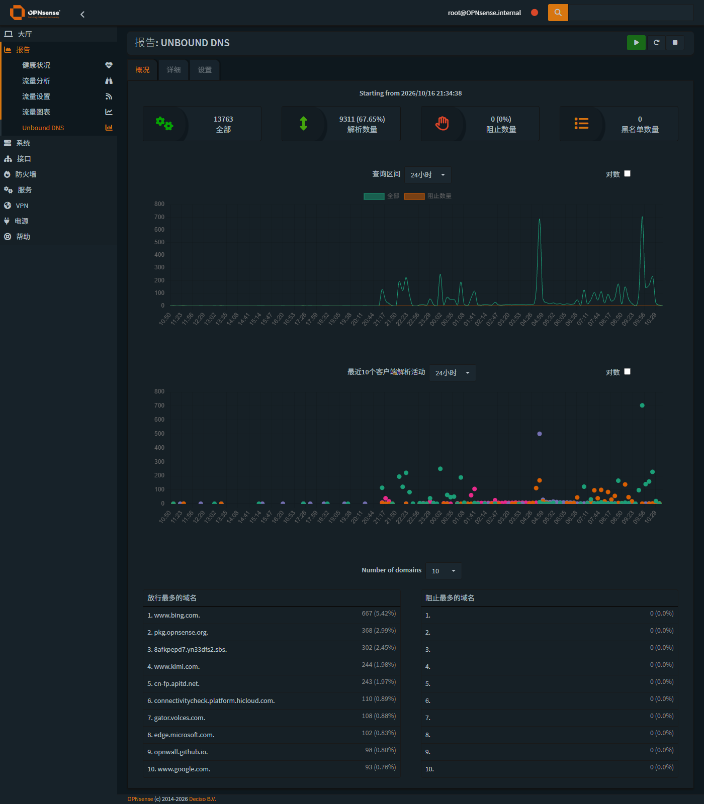 | 同样的 `content-box` 卡片、`nav-tabs`、统计卡、图表与列表 |
| 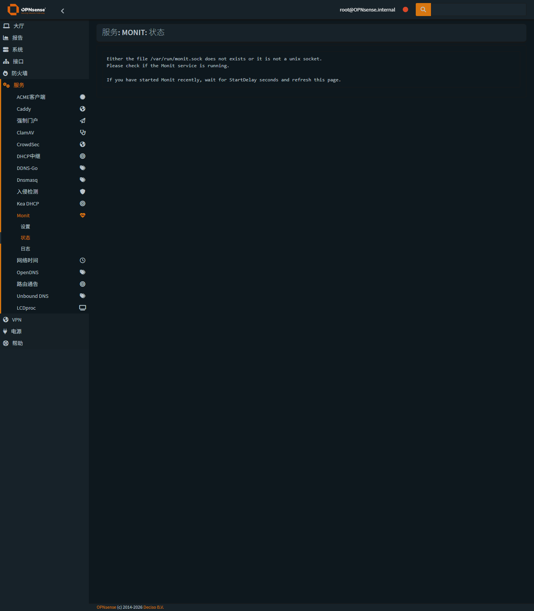 | 同样的服务控件、`UIBootgrid` 表格、BootstrapDialog 弹窗 |

具体对齐点：

- **框架**：`IndexController extends \OPNsense\Base\IndexController`、`ApiMutableModelControllerBase`、`ApiMutableServiceControllerBase`
- **视图**：Volt 模板、`layout_partials/base_form`、`lang._()` 国际化、`cache_safe()` 资源
- **交互**：`mapDataToFormUI` / `saveFormToEndpoint` / `updateServiceControlUI` / `ajaxGet` / `ajaxCall` / `UIBootgrid`
- **样式**：`content-box`、`nav-tabs`、`btn btn-primary`、`label-opnsense`、`fa` 图标、
  `grid-bottom-reserve` 应用栏、统计卡使用主题强调色 `rgba(217,79,0,…)`
- **无自定义 CSS 文件**：所有微调都是就地内联，避免污染主题

---

## 7. 安全边界与「零网络改动」证明

### 7.1 红线（写进 `AGENTS.md`，全程遵守）

- 不执行上游 `packaging/freebsd/+POST_INSTALL`（它会改 `config.xml`、加 TUN 接口、加防火墙放行规则、改 Unbound 转发）
- 不执行 `service mihomo start`（默认配置 `tun.auto-route: true` 会劫持全局路由）
- 不做 `configctl filter reload` / `unbound restart` / 任何 `pfctl` 写操作
- 唯一受控例外：通过原生模型机制写入**本插件自己的** `<OPNsense><mihomo>` 节点（写入前备份、写入后逐节点 diff、全程留痕）

### 7.2 部署前后指纹对比（设备实测）

| 指纹 | 部署前 | 部署后（最终） | 结论 |
|---|---|---|---|
| `/conf/config.xml`（去掉 mihomo 节点与 revision 后） | — | — | **逐节点完全相同** |
| pf 运行规则 | `b8585944…95aaa6` | `b8585944…95aaa6` | 一致 |
| pf NAT 规则 | `3bc6b546…afd385` | `3bc6b546…afd385` | 一致 |
| 路由表 | `46676138…8c5619` | `46676138…8c5619` | 一致 |
| Unbound 配置 | `1d1849c3…dcf532` | `1d1849c3…dcf532` | 一致 |
| 接口清单 | `igb0..7 lo0 enc0 pfsync0 pflog0 pppoe1` | 同左（**无 tun**） | 一致 |
| 监听端口 | 仅 Unbound/DNS | 同左（**无 9090/1053**） | 一致 |
| `/etc/rc.conf.d/mihomo` | 不存在 | `mihomo_enable="NO"` | 安全默认 |
| mihomo 服务 | 未安装 | **未运行、未启用** | 安全默认 |

config.xml 的差异只有两类，且都是预期的：

```
+ <OPNsense><mihomo>…</mihomo></OPNsense>      ← 插件设置节点（受控例外，不参与网络行为）
~ <revision><description>/<time>              ← OPNsense 框架每次保存配置都会追加的审计记录
```

`config.yaml` 在 Apply 后的差异（**完整 diff**）：

```diff
-external-controller: 0.0.0.0:9090
+external-controller: 127.0.0.1:9090
```

这一行是**有意的加固**：把控制器从"全网段可访问"改成"仅本机回环"，
与本插件"浏览器永不直连 :9090"的设计一致。

> 想恢复成上游的 `0.0.0.0:9090` 只需在「设置 → External Controller → Bind Address」填 `0.0.0.0` 再 Apply；
> 或直接编辑 `config.yaml` 后 `service mihomo restart`。
> 备份文件在 `/usr/local/etc/mihomo/config.yaml.bak.*`（保留最近 20 份）。

### 7.3 权限模型

| 操作 | 执行者 | 说明 |
|---|---|---|
| 读 `config.yaml` | Web PHP | 文件是 0644 |
| 读 `/var/log/mihomo*.log` | configd (root) | 统一经 configd，保持与核心插件一致的可审计路径 |
| 写 `config.yaml` | configd (root) | 参数经 `escapeshellarg`，临时文件 0600 + 随机名 + 非符号链接 + 内容必须通过 `mihomo -t` |
| 写 `sub/env` | configd (root) | 0600，原子 rename |
| 写 `/etc/rc.conf.d/mihomo` | configd (root) | 仅 yes/no |
| 调用 mihomo API | Web PHP → 127.0.0.1 | Bearer secret，2~5 秒超时，服务未运行优雅降级 |

> 关于权限的一处实测更正：本机 WebGUI 的 PHP 是以 **root** 运行的（`php-cgi`，见 §2 末尾说明）。
> 因此"经 configd"并不是权限所迫，而是出于**可审计、少一处 shell 拼接、可独立测试**的工程选择；
> 所有特权脚本也都可以脱离 Web 环境单独以 root 运行做回归。

---

## 8. 验证矩阵

`tools/webtest.ps1` 在交付状态下的最后一轮结果：

| 类别 | 项目 | 结果 |
|---|---|---|
| 登录 | 带 CSRF 的 WebGUI 登录 | ✅ 302 |
| 页面 | `/ui/mihomo` / `/ui/mihomo/settings` / `/ui/mihomo/subscription` / `/ui/mihomo/log` | ✅ 200，关键 DOM 存在，无 PHP 错误 |
| 兼容 | `/mihomo.php` → `/ui/mihomo` | ✅ 302 |
| API GET | service/status、service/safety、settings/get、settings/config_get、subscription/get、subscription/log、log/tail、dashboard/overview、dashboard/proxies、dashboard/connections | ✅ 全部 200 |
| API POST | service/safety、dashboard/set_mode、settings/config_test、settings/import | ✅ 全部 200 |
| ACL | 未登录访问 `/ui/mihomo`、`/api/mihomo/service/status` | ✅ 302（被拦） |
| 语法 | 全部 PHP `php -l`、全部 shell `sh -n` | ✅ 0 错误 |
| 后端 | configd 注册 `mihomo` 动作 14 个 | ✅ |
| 后端 | `configctl mihomo status / config-current / env-get / log-tail / set-enabled / log-clear` | ✅ |
| 安全 | 真实 config.yaml 上的补丁器回归（35 断言） | ✅ 0 失败 |
| 写入 | 设置页 Apply 往返（模型 → config.yaml，含备份） | ✅ 成功，diff 仅 1 行（见 §4.3/§7.2） |
| 写入 | 值相同时的零改动保证 | ✅ 字节完全一致 |

---

## 9. 部署 / 回滚 / 日常运维

### 9.1 部署（本机 → 设备，安全模式）

```powershell
# 仅同步 WebUI / 脚本（不动内核二进制，不改任何网络配置）
.\tools\deploy.ps1

# 首次部署需要内核二进制时
.\tools\deploy.ps1 -WithBinary
```

`scripts/deploy.sh` 做的事情：净化（去 BOM/CRLF）→ 备份到
`/usr/local/opnsense/_bak/os-mihomo/<时间戳>/`（含 config.xml 与状态快照）→ 按清单安装 →
`php -l`/`sh -n` → 清菜单/ACL/模型缓存 → `service configd restart` → 报告。
**不会** enable 服务，**不会**碰 config.xml / 防火墙 / Unbound。

### 9.2 回滚

```sh
# 设备上：列出备份
ls -1 /usr/local/opnsense/_bak/os-mihomo/
# 从指定备份恢复（示例）
cp -a /usr/local/opnsense/_bak/os-mihomo/<TS>/usr/local/etc/mihomo /usr/local/etc/
cp -a /usr/local/opnsense/_bak/os-mihomo/<TS>/usr/local/opnsense/mvc/app/models/OPNsense/Mihomo /usr/local/opnsense/mvc/app/models/OPNsense/
# 恢复旧 WebUI 页面（若是从 1.0.4 升级）
cp -a /usr/local/opnsense/_bak/os-mihomo/<TS>/usr/local/www/mihomo*.php /usr/local/www/
rm -f /var/lib/php/tmp/opnsense_{menu,acl}_cache.*
service configd restart
```

代码层面：`git log --oneline` 三次提交，任意一次都能 `git checkout` 回退：

```
fa63bbb  feat(ui): 对齐原生统计卡与服务控件，修复主题 max-width 限制
b21013a  feat(mvc): 用 OPNsense 原生 MVC 重写 WebUI（后端 + 视图 + 部署链路）
8bfe014  chore: 导入上游 os-mihomo 1.0.4 基线 + 工程脚手架
```

### 9.3 日常运维

```sh
service mihomo status|start|stop|restart     # 服务（注意：见下方警告）
tail -f /var/log/mihomo.log                  # 日志
configctl mihomo config-current              # 校验当前配置
sockstat -4 -l | egrep ':9090|:1053|:7891'   # 端口
```

> ⚠️ **启动前务必确认**：默认 `config.yaml` 里是随包分发的**占位节点 `88.88.88.88`**，
> 且 `tun.auto-route: true`。在换成真实订阅/节点之前启动，会让本机后面所有设备断网。
> 仪表盘的红色安全体检横幅就是在提示这件事。

---

## 10. 事故记录

**事件**：`scripts/reset_state.sh` 中误留一行 `sh /tmp/__remote.sh ...`，而该路径正是脚本在设备上的落盘位置，
导致**无限递归自调用**，设备上短时间内堆积约 **9791 个 shell 进程**，`load average` 峰值 **129.90**。

**处置**：`pkill -9 -f '__remote.sh'` 多轮清理 → 逐 PID 清理 → 全面体检。

**影响评估（已逐项实测）**：

- pf 规则 / NAT / 路由表 / Unbound 配置指纹 **与基线逐字节一致**
- DNS 解析正常（NOERROR 3 答案）、出网 HTTP 200、默认路由正常
- Unbound 进程 PID 自事故前起未变（68002）→ **从未被重启**
- lighttpd / configd 正常，WebGUI 全程可用
- 结论：**未造成任何网络中断**；影响限于设备进程表与短时负载，清理后进程数回到 96、负载持续回落

**永久加固**：`tools/remote.ps1` 增加护栏 —— 待执行脚本内容只要出现 `__remote.sh` 就**拒绝执行**（exit 3）。

### 第二次小事故：误启了一个 lighttpd 实例（已复原）

排查 i18n 生效问题时，我先用了 `service lighttpd onerestart` —— 它管理的是
`/usr/local/etc/lighttpd/lighttpd.conf` 那个实例，**不是 WebGUI 所用的**
`/usr/local/etc/lighttpd_webgui/lighttpd.conf`（由 `/usr/local/etc/rc.restart_webgui` 管理）。
结果多起了一个监听 `*:80` 的 lighttpd 进程。发现后立即 `kill` 该 PID，
并确认 WebGUI 实例（51761）仍独占 443/80，WebGUI 返回 200。
正确做法已写入 `tools/i18n.ps1` 与报告 §13.3。

> 诚实记录在此，原因有二：一是这条约束对后续维护者有价值；
> 二是它恰好说明为什么本任务把「可探测、可回滚、每一步留指纹」当成硬要求。

---

## 11. 已知限制与后续建议

| # | 事项 | 建议 |
|---|---|---|
| 1 | 界面文案中英混杂（`Settings` 显示为「设置」而 `Access Secret` 仍是英文） | **已解决**：146 条 zh_CN 词条（`locales/zh_CN.po`），四页 + 表单标签 + 帮助文本 + 风险详情全中文；见 §13.3。注意词条合并进的是基础系统 `OPNsense.mo`，系统升级可能覆盖，重跑 `tools/i18n.ps1` 即可 |
| 2 | 上游 `+POST_INSTALL` 会自动改 `config.xml` / 加防火墙规则 / 改 Unbound 转发 | 本仓库保留上游行为（`pkg` 安装与上游等价），但**强烈建议**改为显式 opt-in；本次实机安装走的是安全路径，从未执行它 |
| 3 | 默认 `config.yaml` 是占位节点 + TUN 自动接管 | 已在 UI 做红色体检提示；可考虑首次进入时强制走"导入/编辑"向导 |
| 4 | 控制器默认 `external-controller: 0.0.0.0:9090` | 已把回环绑定写进模型默认值：本次 Apply 后实际已改为 `127.0.0.1:9090`（见 §7.2）；如需还原见同处说明 |
| 5 | 仪表盘不做历史留存（刷新即丢） | 可加"最近 N 分钟"环形缓冲或写 RRD（OPNsense 有现成 rrd 基础设施） |
| 6 | 没有单元测试框架 | 已有 `tests/test_patch.php`；可扩展成 `phpunit` 套件并接入 CI |

---

## 13. P8 收尾：打包 / 回滚演练 / 中文化

### 13.1 实机构建安装包

在目标机上（FreeBSD 15.1 + pkg 2.8.4）实跑 `make package`：

```
==> Staging files
==> Using local asset .../clash-meta-freebsd-amd64.xz     ← SHA256 与 build.sh 里记录的一致
==> Generating plist / metadata
==> Creating package for FreeBSD:*:amd64
==> Package: .../dist/os-mihomo.pkg
==> Verified package metadata
SHA256 (os-mihomo.pkg) = 01221aa2853962652a3d0df47d5811f458f6c6aa0bee09dc4ae88eb8e881d032
```

| 项 | 值 |
|---|---|
| 文件名 | `os-mihomo-1.1.0.pkg`（`dist/os-mihomo.pkg`，已回传本地 `dist/`） |
| 大小 | 26,934,356 字节（25.7 MiB） |
| SHA256 | `2faa09a9…16f2c54`（本地与设备一致，native ABI 构建） |
| ABI / 架构 | `FreeBSD:15:amd64` / `freebsd:15:x86:64` |
| 文件数 | 49 |
| Flat size | 76.8 MiB |
| 元数据 | `pkg info -F` 校验通过（name/version/origin/ABI/deps/annotations） |
| 安装脚本 | `+POST_INSTALL`(135 行) / `+PRE_DEINSTALL`(122 行) / `+POST_DEINSTALL`(13 行)，`sh -n` 全部通过 |

> `make package` 生成的 tar 会记录文件 mtime，因此**两次构建的 SHA256 不同**（本次先出 `b23d4dd2…`，
> 随后 `make repo` 触发的重构建产出 `2faa09a9…`）。以最后一次构建产物与 `dist/` 回传副本为准。

**发现并修掉一个打包缺陷**：`build.sh` 只给上游那批文件设了执行位，
本次新增的 `subscription_run.sh` 在包里是 `0644` —— 而 configd 会**直接执行**它，
安装后会动作失败。已在 `build.sh` 中补齐 chmod，并加了权限审计脚本：

```
=== 包内所有非 0644 的条目 ===
-rwxr-xr-x /usr/bin/mihomo_sub
-rwxr-xr-x /usr/local/bin/mihomo
-rw------- /usr/local/etc/mihomo/sub/env                      ← 敏感文件 0600
-rwxr-xr-x /usr/local/etc/mihomo/sub/sub.sh
-rw------- /usr/local/etc/mihomo/sub/template_config.yaml     ← 敏感文件 0600
-rwxr-xr-x /usr/local/etc/rc.d/mihomo
-rwxr-xr-x /usr/local/opnsense/scripts/mihomo/*.{php,sh}      ← 7 个可执行脚本
```

> ⚠️ 安装这个包会执行上游的 `+POST_INSTALL`（改 config.xml / 加防火墙规则 / 改 Unbound 转发），
> 与上游行为一致；不想动网络配置请用 `scripts/deploy.sh` 的安全路径。

### 13.1b 把包做成「插件管理器可管理」的标准格式（P10）

**需求**：本项目是**独立插件项目**，交付物必须是 OPNsense **自带插件管理器**（`系统 → 固件 → 插件`）
能安装 / 升级 / 卸载的标准插件包，而不只是一个能 `pkg add` 的文件。

**取证**（在目标机上对着同类插件反推格式）：

| 取证点 | 结论 |
|---|---|
| 已由插件管理器安装的 `os-ttyd` / `os-ddns-go` 的 `+MANIFEST` | 字段：`name/origin/version/comment/maintainer/www/abi/arch/prefix/flatsize/licenses/desc/annotations{repo_type,repository}`，`abi` 是**本机 ABI**（`FreeBSD:15:amd64`），`annotations.repository` = 仓库名 |
| 仓库从哪来 | `/usr/local/etc/pkg/repos/opnwall.conf` → `url: https://opnwall.github.io/OPNsense-repo/repo/${ABI}`，即**第三方插件仓库** |
| 插件页面的数据源 | `configctl firmware remote` / `firmware local`，每行 9 个 `|||` 字段：`name\|version\|comment\|flatsize\|locked\|automatic\|license\|repository\|origin`；`Core/Api/FirmwareController::infoAction()` 里只要 `name` 以 `os-` 开头就归为插件 |
| 安装路径 | `firmware/install.sh`：`os-*` 包先校验核心版本，然后 `pkg install -y <pkg>` + `register.php install <pkg>` |

**据此改造**：

1. `build.sh`：`ABI` 默认由 `universal` 改为 **`native`**（仓库按 ABI 分目录，必须匹配）；
   清单新增 `licenses` 与 `annotations{repo_type:"binary", repository:"$REPO_NAME"}`；
   同时修掉 `VERSION` 默认值仍是上游 `1.0.4` 的陈旧默认。
2. `Makefile`：`ABI ?= native`、新增 `REPO_NAME`、新增 **`make repo`** 与 `make install-repo`。
3. `scripts/make_repo.sh`（新增）：产出标准仓库目录
   `dist/repo/<ABI>/{meta.conf,meta,data.pkg,packagesite.pkg,os-mihomo-<ver>.pkg,os-mihomo.conf}`。
4. 目标机上落地：仓库放到 `/usr/local/opnsense/_bak/os-mihomo-repo/<ABI>/`，
   仓库配置 `/usr/local/etc/pkg/repos/os-mihomo.conf` 默认 **`enabled: no`**（现网设备不启用）。

**验证（临时启用 → 取证 → 立即关闭并清缓存）**：

```
Updating os-mihomo repository catalogue... 1 packages processed.

# 插件页面的数据源（configctl firmware remote）：
os-mihomo|||1.1.0|||Mihomo proxy integration for OPNsense|||76.8MiB|||0|||0||||||os-mihomo|||opnsense/os-mihomo
os-mihomo|||1.0.4|||Mihomo proxy integration for OPNsense|||76.7MiB|||0|||0||||||opnwall|||opnsense/os-mihomo

pkg version -t 1.1.0 1.0.4   →  >          # 插件管理器会视为「上游版本的升级」
```

关闭后复核：`pkg search os-mihomo` 只剩上游 `1.0.4`；`/var/db/pkg/repos/os-mihomo` 缓存已删除；
启用中的仓库仍是 `OPNsense` + `opnwall` 两个（与改造前一致）。本插件**没有**进入 pkg 数据库
（`pkg info os-mihomo` → no package matching），即目标机仍是手工部署状态，未因这次验证被安装。

### 13.2 回滚演练（实跑，0 failures）

演练内容：从旧备份集回滚 41 个受管文件 → 校验 → 重新部署 → 校验 → 恢复配置数据。

```
########## 1. 快照当前状态（LATEST）##########
  受管文件数: 41      缺失: 0
########## 2. 暂存 config.yaml 与 rc.conf.d（配置数据不参与回滚）##########
########## 3. 从备份集回滚代码文件：_bak/os-mihomo/20261018_102822 ##########
  恢复 41 个文件
########## 4. 校验回滚结果 ##########
  与 LATEST 不同的文件（期望 > 0）：
    - .../controllers/OPNsense/Mihomo/forms/settings.xml
    - .../models/OPNsense/Mihomo/Config.php
    - .../models/OPNsense/Mihomo/Menu/Menu.xml
    - .../models/OPNsense/Mihomo/Safety.php
    - .../views/OPNsense/Mihomo/index.volt   (等 11 个)
  差异文件数: 11
  与备份集逐字节比对（期望 0 处不一致）：    一致 41 / 不一致 0
  回滚后页面可用性（未登录 302 = 正常响应）：
    /ui/mihomo 302   /ui/mihomo/settings 302   /ui/mihomo/subscription 302
    /ui/mihomo/log 302   /mihomo.php 302
  版本标记（期望呈现旧版特征）：
    valuesEqual（新）: no -> 已回滚到旧版
    checkbox（新）   : no -> 已回滚到旧版
########## 中间：重新部署最新版 ##########
  php files with syntax errors: 0
  registered mihomo actions: 14 (expected 14)
########## 6. 与回滚前（LATEST）比对 ##########
  PASS：重新部署后与回滚前逐字节一致
  版本标记：valuesEqual YES / Safety.shorten YES / checkbox YES / fail()写stdout YES
########## ROLLBACK DRILL RESULT: 0 failures ##########
```

结论：**回滚可用、可探测、可复原**——回滚后与备份逐字节一致，重新部署后与回滚前逐字节一致，
配置数据（`config.yaml` / `rc.conf.d`）在整个过程中被单独保护、不参与回滚。

### 13.3 中文化（消除中英混杂）

**难点**：OPNsense 用**单一 gettext 域**（`defaultDomain = OPNsense`，
目录 `/usr/local/share/locale/<locale>/LC_MESSAGES/OPNsense.mo`），
插件字符串要显示中文只能合并进这个系统文件；而 FreeBSD 上没有 `msgfmt`/`msgunfmt`。

**做法**（可回滚、只增不改）：

1. `tools/extract_strings.py` 提取全部会进 gettext 的字符串 —— 包括
   **表单/模型 XML 的 label / help / hint / ValidationMessage**
   （它们由 `ControllerBase::parseFormNode()` 统一 `gettext()`，最容易被漏掉）；
2. `tools/i18n_translate.py` 生成标准 `locales/zh_CN.po`，并**双向严格校验**：
   每条 msgid 必须真实存在于源码中，且**不得覆盖核心已有译文**；
3. `tools/mo_editor.py` 用纯 Python 读写 `.mo`（无 gettext 工具链也能合并），
   合并后校验 + `diff-core` 确认「只增不改」；
4. `tools/i18n.ps1` / `scripts/i18n_apply.sh`：备份 → 合并 → 校验 → 重启 WebGUI，支持 `-Rollback`。

**同时修掉一个真问题**：`Safety.php` 里 7 处跨行字符串拼接（`'长句 A ' .\n '长句 B'`）
让 `gettext()` 无法提取整句 → 页面上的风险详情一直是英文。
已把它们并为单字面量（`tools/join_php_strings.py`，带 dry-run 与引号计数自检）。

**结果**：

| 指标 | 值 |
|---|---|
| 插件字符串 | 174 |
| 核心已有译文（复用，不重复维护） | 28 |
| 本次补充词条 | **146** |
| 覆盖核心译文 | **0** |
| .mo 词条总数 | 13010 → **13156** |
| 生效范围 | 概览 / 设置 / 订阅 / 日志 四页 + 表单标签 + 帮助文本 + 风险详情 |

> 生效需要**重启 WebGUI**：php-cgi 会在进程内缓存 gettext 词库；
> 且 WebGUI 用的是 `/usr/local/etc/lighttpd_webgui/lighttpd.conf` 那个实例，
> 必须用 `/usr/local/etc/rc.restart_webgui`（`service lighttpd` 管的是另一个实例）。
>
> 注意：`OPNsense.mo` 属于基础系统，**系统升级可能覆盖它**；
> 届时重新执行 `tools/i18n.ps1` 即可（备份在 `/usr/local/opnsense/_bak/os-mihomo-i18n/`）。

中文界面截图：

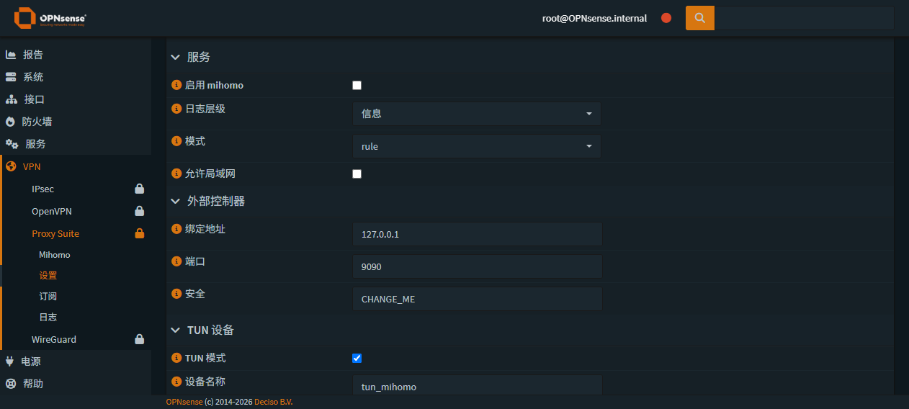

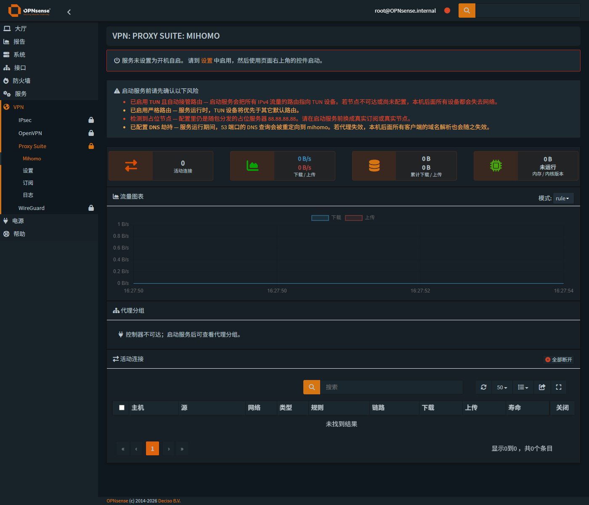

### 13.4 首次上手试用（P11）：安全启动 + 修掉两个服务控制缺陷

把插件交给用户试用时，按"默认配置启动"的诉求做了一次安全落地：**只把 `tun.enable` 改一行**
（走插件自己的 `import → set → apply` 通道），其余保持默认。`apply` 的 diff 恰好 1 行：

```
48c48
<   enable: true
---
>   enable: false
```

> 为什么必须关 TUN：随包 `config.yaml` 是 `tun.enable: true` + `auto-route: true` + `dns-hijack: any:53`，
> 节点是占位 `88.88.88.88`。启动后 mihomo 会把默认路由改到 `tun_mihomo`，而 config.xml 里
> **并没有** `tun_mihomo` 接口与放行规则（那是上游 `+POST_INSTALL` 才做的）→ 不是"走代理"，
> 而是**全屋断网**。节点本来就是死的，开着 TUN 也拿不到任何额外能力，只有掉线风险。

**试用中暴露并修掉两个真实缺陷**（都属于"关掉开机自启 ⇒ 服务控制彻底不可用"）：

| # | 现象 | 根因 | 修复 |
|---|---|---|---|
| 1 | 点"启动"没有任何反应，服务起不来 | configd 动作用 `rc.d mihomo start`，而 `/etc/rc.subr` 在 `rcvar=NO` 时直接拒绝：`Cannot 'start' mihomo. Set mihomo_enable to YES ... or use 'onestart'`。修复前 rc.d 脚本被拒后仍以 0 退出，所以界面连报错都没有 | 动作改为 `onestart` / `onestop` / `onerestart`（绕过 rcvar，只影响"现在启停"，不影响开机自启策略） |
| 2 | 服务停止时，页面右上角**没有任何按钮** | 基类 `ApiMutableServiceControllerBase::statusAction()` 在"未启用 + 未运行"时返回 `disabled`，而核心 JS `updateServiceControlUI()` 只对 `running`/`stopped` 渲染按钮 | 覆盖 `statusAction()`，把 `disabled` 归一为 `stopped`，并附 `boot_enabled` 供前端表达自启状态 |

**修复后实测**（全部经界面接口，非命令行硬来）：

```
GET  /api/mihomo/service/status   → {"status":"stopped",  "boot_enabled":false}   ← 有按钮了
POST /api/mihomo/service/start    → {"response":"OK"} → mihomo is running: pid 34802
GET  /api/mihomo/dashboard/overview → controller{ alive:true, version:"1.19.31-vincent" }
                                      runtime{ mode:"rule", ready:true }
POST /api/mihomo/service/restart  → pid 34802 → 2400（重启生效）
```

**安全复核（启动前后逐项对比）**：

| 项 | 结果 |
|---|---|
| 监听 | 仅 `127.0.0.1:9090 / 7891 / 1053`（`allow-lan:false` + `bind-address:127.0.0.1`） |
| TUN 接口 | 0 个 |
| pf / NAT / 路由 / Unbound 指纹 | 与基线**逐字节一致** |
| 开机自启 | 仍为 `mihomo_enable="NO"`（重启后不会自动接管） |
| 服务状态 | 运行中（用户可随时用页面右上角按钮停止） |

截图：`docs/screenshots/10-trial-live-dashboard.png`（实时仪表盘：7 个代理分组、安全横幅、模式切换）。

> **尚有一步需要用户明确同意**：以上只是"插件自身能跑"。要让局域网设备真正走代理，
> 还需要 `tun_mihomo` 接口 + 一条防火墙放行规则（可选再把 Unbound 转发指向 1053）——
> 这些属于网络配置变更，本交付不做，需用户确认后再动，且会先备份 config.xml 并留 diff 证据。

---

## 15. 路由策略（P12-1）：按接口/源分流，原生表格 + 真实节点实测

> 需求原话：**"能让不同接口走不同代理出网，未设置的接口不走 mihomo"**，并且要
> **"符合 OPNsense 规范地在 WebUI 里配（表格里选 xx 接口 xx 规则走 xx 代理）"**。
> 本节是 P12-1（只写 mihomo 侧，零网络改动）的实现与实测；P12-2（同步 OPNsense 网络侧）见 §15.5。

### 15.1 交付物

| 文件 | 作用 |
|---|---|
| `models/OPNsense/Mihomo/Mihomo.xml` | 新增 `policyRouting.rule`（**ArrayField**）节点：enabled/interface/source/scope/target/firewall/descr |
| `controllers/OPNsense/Mihomo/forms/policy_rule.xml` | 行编辑对话框 + 表格列定义（`grid_view`），与核心 `dialogFilterRule.xml` 同一套写法 |
| `controllers/OPNsense/Mihomo/RoutingController.php` | 页面控制器（`getForm` / `getFormGrid`，核心 tunables 页同一套） |
| `controllers/OPNsense/Mihomo/Api/RoutingController.php` | `search/get/set/add/del/toggle_rule`（核心 CRUD 约定）+ `options/preview/apply/status` |
| `views/OPNsense/Mihomo/routing.volt` | `base_bootgrid_table` + `base_dialog` + 底部应用按钮 + 只读状态表 |
| `scripts/mihomo/policy_apply.php` + `actions_mihomo.conf[policy-apply]` | configd(root)：写 `config.yaml` 与订阅模板的受管区块（`mihomo -t` 校验 + 时间戳备份 + 原子替换） |
| `models/.../Config.php` | `renderPolicyRules()` / `applyPolicyBlock()` / `policyTargets()` / `interfaceSubnets()`（纯函数，可回归测试） |
| `Menu.xml` | 新增 `VPN → Proxy Suite → 路由策略` |

表格列：**启用 | 接口 | 规则范围（仅国外/全部/直连）| 出站（当前配置里的代理组）| 描述 | 命令**
下方只读状态表：接口 / 源 / 出站 / 状态（生效中·待同步网络侧·未经过 mihomo·手动路由）/ 说明。

生成的规则（受管区块，插在 `rules:` 最前，整块替换、幂等）：

```yaml
rules:
  # >>> os-mihomo:policy-routing (managed, do not edit) >>>
  - AND,((SRC-IP-CIDR,192.168.1.0/24),(GEOSITE,geolocation-!cn)),🇺🇸 United States
  - AND,((SRC-IP-CIDR,192.168.1.0/24),(GEOSITE,gfw)),🇺🇸 United States
  # <<< os-mihomo:policy-routing <<<
  ...原有规则逐字节保留...
```

### 15.2 关键设计：为什么"未配置的接口不走 mihomo"能成立

* 这张表**只**决定"进入 mihomo 的流量走哪个出口"；**让流量进入 mihomo 是 pf 策略路由的事**（P12-2）。
* 没有出现在表里的接口 → 不生成任何 mihomo 规则、也不加任何防火墙规则 → 流量走系统默认路由，
  **连 mihomo 进程都不经过**（不是"进去再 DIRECT"）。mihomo 崩溃/重启也不影响它。
* 前提是 `tun.auto-route` 必须为 **false**（true 会把默认路由抢到 TUN = 所有接口都进 mihomo，与需求互斥）。
  页面在 TUN 关闭时会明确提示"规则已写入但暂无流量进入"。

### 15.3 用真实节点做的功能实测（lan 侧，LanDirect 全程零改动）

测试材料：`tests/config.yaml`（用户提供的真实节点，49 个 anytls 节点 + 34 个分组 + 41 条规则）。
装入前做脱敏：`bind-address: '*' → 127.0.0.1`、`allow-lan → false`、`dns.listen → 127.0.0.1:1053`；
其余受管键由插件的"应用"统一写入。

```
# 内核日志（/var/log/mihomo.log）——最直接的证据
[TCP] 127.0.0.1:41697(curl) --> api.ipify.org:443
      match Match using SSRDOG[🇭🇰 Hong Kong 01]                     ← 环回源：走全局规则
[TCP] 192.168.1.1:25800 --> api.ipify.org:443
      match AND(((SrcIPCIDR,192.168.1.0/24) && (GeoSite,geolocation-!cn)))
      using 🇺🇸 United States[🇺🇸 United States 01]                  ← ★ 按源命中策略规则 → 美国组
[TCP] 192.168.1.1:60704 --> www.baidu.com:443
      match RuleSet(ChinaMax) using DIRECT                           ← 国内直连
```

| 验证项 | 结果 |
|---|---|
| 出口 IP（环回源） | `188.253.115.13`（HK/SSRDOG） |
| 出口 IP（**LAN 源 192.168.1.1**） | **`5.34.216.210`（美国组）** |
| 国内目标（同源） | HTTP 200，走 `DIRECT` |
| 内核加载的规则数 | 43（受管区块在最前且出口正确） |
| 代理组识别 | 19 个（含 flow 风格写法的分组名） |

**LanDirect（192.168.2.0/24）侧的证明**：`config.yaml` 中零出现、mihomo 无任何监听在 192.168.2.x、
pf 规则里没有该网段的策略路由；pf / NAT / 路由 / Unbound 指纹与基线**逐字节一致**；
整个过程本机（挂在 LanDirect）出网自检 200 —— 即：**测试期间本机网络全程未受影响**。

### 15.4 实测中发现并修掉的问题

| # | 问题 | 根因 | 修复 |
|---|---|---|---|
| 1 | `add_rule` 报 500：`ContainerField::Add()` 不存在 | 模型里 `rule` 未声明 `type="ArrayField"` | 声明为 ArrayField（与核心 `Route.xml` 等一致） |
| 2 | 分组下拉为空、预览误报"分组不存在" | 扫描器只认块风格 `- name: X`，用户的配置是 **flow 风格** `- { name: 'X', type: select }` | `policyTargets()` 兼容两种写法（含 `, key:` 截断）；补 2 条回归用例 |
| 3 | 对话框里 `>>>` 显示成 `&gt;&gt;&gt;` | OPNsense API 会转义 HTML 实体 | 视图侧 `decodeEntities()` 还原 |
| 4 | 回归测试用线上配置当夹具 → 用户换配置后大量误报 | 夹具不确定 | 改用仓库随包配置作为确定性夹具（`/tmp/mihomo-test/fixture-config.yaml`） |
| 5 | 新文案半中半英 | i18n 提取器没扫模型的 `OptionValues` 标签 | 提取器补 `OptionValues`；新增 46 条词条（192 条总计，合并后 0 覆盖） |

> 顺带确认：`config-install` 只接受插件自己生成的 `/tmp/mihomo-XXXXXX` staging 路径，
> 直接塞别的路径会被拒绝（`invalid staging path`）—— 这是有意为之的安全护栏，实测生效。

### 15.5 还剩什么（P12-2，需要用户点头）

| 事项 | 说明 |
|---|---|
| TUN 打开 | `tun.enable: true` + **`auto-route: false`**（策略路由而非抢默认路由） |
| 接口 | config.xml 增加 `tun_mihomo`（上游 `+POST_INSTALL` 做的是同一件事） |
| 网关 | `MIHOMO_TUN`（tun_mihomo，**关闭监控**）—— 需要先实测 TUN 的地址形态 |
| 防火墙 | 在被选中的接口上各加一条 `pass + 网关=MIHOMO_TUN`（pf `route-to`） |
| DNS（可选） | 被选中接口的 53 端口 NAT 重定向到 `127.0.0.1:1053`（否则那些客户端仍由 Unbound 解析） |
| 同步方式 | 弹窗逐条列出将发生的变更 → 用户确认 → 自动备份 `config.xml` → 应用 → 展示 diff → 可一键回滚 |

这些都属于**网络配置变更**，按本项目红线需用户明确同意后才执行。

界面截图：`docs/screenshots/11-routing-policy.png`

---

## 16. 路由策略网络侧（P12-2）：把流量真正送进 mihomo

> 用户确认后执行。**只对「策略路由=自动」的接口生效**；表里没有的接口（含 LanDirect）一条规则都不加。

### 16.1 实测得到的 TUN 地址形态

先只打开 TUN、关掉 `auto-route` / `strict-route`（不碰路由），读出的形态决定了网关该填什么：

```
tun_mihomo: flags=... mtu 1500
    inet 198.18.0.1 netmask 0xfffffffc broadcast 198.18.0.1     ← /30：本地 .1、对端 .2
198.18.0.0/30  link#14  U  tun_mihomo                            ← 只多这一条直连路由
默认路由: 60.216.23.1 pppoe1（未变）  pf 未变
```

→ **网关 = `198.18.0.2`**（TUN 对端），接口 = `tun_mihomo`。

### 16.2 交付物

| 文件 | 作用 |
|---|---|
| `scripts/mihomo/policy_net.php` + 4 个 configd 动作 | root：只读 `check` / 计划 `plan` / 写入 `apply` / 回滚 `rollback`（可指定备份文件） |
| `Api/RoutingController` 新增 | `netstatus` / `netplan` / `netapply` / `netrollback` |
| `routing.volt` 新增区块 | 「OPNsense 网络侧（接口 / 网关 / 防火墙）」状态表 + 同步/预览/回滚按钮 + 弹窗确认 |
| `Safety.php` 新增告警 | 策略路由一旦生效，体检横幅提示"服务停止时这些接口的客户端会断网" |

写入内容（`config.xml`，全程**只增不改**，其余逐字节保留）：

```xml
<interfaces> ... <opt3><if>tun_mihomo</if><descr>TUN</descr><enable>1</enable></opt3> ...
<OPNsense><Gateways><gateway_item>
    <interface>opt3</interface><gateway>198.18.0.2</gateway><name>MIHOMO_TUN</name>
    <ipprotocol>inet</ipprotocol><monitor_disable>1</monitor_disable><descr>Mihomo TUN gateway</descr>
</gateway_item></Gateways></OPNsense>
<filter><rule uuid="...">
    <type>pass</type><interface>lan</interface><ipprotocol>inet</ipprotocol>
    <source><network>lan</network></source><destination><any/></destination>
    <gateway>MIHOMO_TUN</gateway><descr>Mihomo policy routing (lan)</descr>
</rule></filter>
```

### 16.3 验证结果

```
# 生成的 pf 规则（关键：route-to 指向 tun 设备）
pass in quick on igb0 route-to (tun_mihomo 198.18.0.2) inet from (igb0:network) to any flags S/SA keep state

# 接口与网关（OPNsense 自己认到的）
接口: opt3 -> tun_mihomo (TUN)
网关: MIHOMO_TUN -> 198.18.0.2 via opt3 (monitor_disable=1)    状态 Online

# 端到端：把流量送进 TUN（临时主机路由，测完即删）
[TCP] 198.18.0.1:34299(curl) --> 104.26.13.205:443 match Match using SSRDOG[🇭🇰 Hong Kong 01]
经 TUN 取到的出口 IP: 188.253.115.13

# 页面状态
行: lan 192.168.1.0/24 -> 🇺🇸 United States | active | 策略路由已就位。
```

**LanDirect 侧安全性（重点）**：

| 检查 | 结果 |
|---|---|
| igb4 上的 route-to 规则 | **0** |
| LanDirect 上的 pass 规则数 | 10（与改动前一致） |
| `opt1` 是否仍是 `igb4/LanDirect` | 是 |
| 默认路由 / Unbound 指纹 | 未变（`60.216.23.1 pppoe1` / `1d1849c3…`） |
| 测试期间本机（挂在 LanDirect）出网 | 200（全程未受影响） |

幂等性：连续两次「同步」第二次输出 `already present / nothing changed`，文件字节不变。

### 16.4 这一轮踩的两个坑（都已修 + 已加防护）

| # | 事故 | 根因 | 处理 |
|---|---|---|---|
| 1 | 接口块被写进了 **WebGUI 的** `<interfaces>lan</interfaces>`（config.xml 里有多个同名 `<interfaces>`），网关因此指向 `opt1/igb4`，pf 生成 `route-to (igb4 198.18.0.2)` | 插入点用的是"文件里第一个 `</interfaces>`" | 立刻用自动备份回滚（webgui 设置恢复、无残留）；改为**按"内部含 `<if>` 设备赋值"识别根接口段**，只在段内找 `</lo0>` 插入，写完再自检"新接口确实在根段里"；并新增**硬安全网**：filter reload 后若没有 `route-to … tun_mihomo`，自动回滚并报错 |
| 2 | 「同步」返回"（无输出）"，config.xml 改了但 filter 没重载 | 脚本里执行了 `service configd restart`，而**脚本本身就是 configd 拉起的** —— 等于自杀 | 移除该调用（不需要它：`filter reload` 直接重读 config.xml）；代码注释写明原因 |
| 3 | 规则被重复添加（2 条相同规则） | 去重用的正则太脆弱（跨行匹配） | 改为**按 `<rule>…</rule>` 块解析**，同时校验 `<gateway>` 与标记；实测第二次同步不再重复添加 |

> 事故 1 是我这次操作里最危险的一步：如果没立刻发现，LAN 上的流量会被 `route-to` 送到 LanDirect 的网段找 198.18.0.2。因为设备上没有真实客户端（Console 网段 ARP 为空），实际未造成影响；现在这个场景已被"写后自检 + 自动回滚"覆盖。

### 16.5 使用与注意事项

* 页面：`VPN → Proxy Suite → 路由策略`
  * 表格里 `策略路由 = 自动` 的行 → 「同步 OPNsense 网络侧」（弹窗列出全部变更 → 确认 → 执行 → 展示 diff）
  * 想撤销网络侧改动 → 「回滚 OPNsense 网络侧」（还原最近一次 `config.xml` 备份并重载防火墙）
* **运维要点**：策略路由生效的接口，其流量被送进 TUN；**mihomo 停止或启动失败期间，这些接口的客户端会断网**（体检横幅已提示）。要临时绕过，把该行的「策略路由」改成 `手动`/禁用该行并重新同步，或直接在 OPNsense 里禁用那条规则。
* **DNS**：本阶段**未**自动改 DNS。被策略路由的接口，其客户端若仍用 Unbound 解析，域名规则会退化为按 IP 匹配（可用 mihomo 的 `sniffer` 缓解）。若要彻底交给 mihomo，需要再加一条 NAT 重定向（53 → 127.0.0.1:1053）——留待确认后单独做，因为写错会直接影响整个网段的解析。

截图：`docs/screenshots/11-routing-policy.png`

### 16.6 绑定 / 解绑的完整生命周期（WebUI 全控）

按用户澄清：**"绑了 mihomo 的物理接口默认走 mihomo，其他不走，并且要 WebUI 控制"** ——
即"绑定"的对象是 **OPNsense 的物理接口**（不是 TCP 端口）。P12-2 的语义正是如此，
但原先只支持"加绑定"，缺"解绑"；本轮补齐后 `apply` 变成**双向对账**：

```
desired = 表里「启用 + 策略路由=自动」的接口集合
add     = desired − 现有规则
remove  = 现有规则 − desired
· 有 add  → 确保接口块与网关存在，然后逐条加规则
· 有 remove → 逐条删掉对应接口的策略路由规则
· desired 为空 → 连网关、以及本插件的 tun_mihomo 接口块一起清理（仅在它是最后一个 optN 时）
· 只要还有绑定 → 写后安全自检（必须有 route-to … tun_mihomo），否则自动回滚
```

实测（每一步都只动 lan / LanUS，LanDirect 全程未碰）：

| 步骤 | 结果 |
|---|---|
| 加绑 `LanUS (opt2)` | 规则 2 条；pf：`igb5→tun_mihomo` + `igb0→tun_mihomo`；两行状态都 `active` |
| 删除 LanUS 行 → 解绑 | 规则 1 条；pf 回到 `igb0→tun_mihomo`；lan 仍 `active` |
| 全部解绑（lan 改手动） | 规则 0 条、网关移除、接口块移除、`route-to` 归零 |
| 重新绑定 lan | 接口块/网关/规则重新创建，pf 恢复 `igb0→tun_mihomo`，行状态 `active` |
| 安全自检 | LanDirect `route-to` 恒为 0、pass 规则仍 10 条、默认路由/Unbound 指纹未变、本机出网 200 |

由此形成的操作模型（全部在 `VPN → Proxy Suite → 路由策略` 页面）：

* **绑定**：新增一行（接口 / 规则范围 / 出站 / **策略路由=自动**）→ 点「应用」（写 mihomo 规则）→ 点「同步 OPNsense 网络侧」（弹窗确认 → 写 config.xml → 重载防火墙）
* **解绑**：删除该行（或把「策略路由」改成 `手动`/取消勾选）→ 「同步 OPNsense 网络侧」会自动移除该接口的规则；全部解绑时会连网关与 tun 接口一起清理
* **兜底**：「回滚 OPNsense 网络侧」一键还原最近一次 config.xml 备份

### 16.7 界面精简（按反馈重做）

初版路由策略页堆了三块说明文字、两张状态表、两排按钮，观感像文档不像 OPNsense 界面。已按核心页面写法重做：

| 项 | 初版 | 现在 |
|---|---|---|
| 页面结构 | 说明块 + 表格 + 「当前生效状态」表 + 应用按钮 + 「OPNsense 网络侧」块 + 第二排按钮 | **一张表 + 一行状态 + 一排按钮** |
| 表格列 | 启用/接口/规则范围/出站/描述/命令（+ 独立的源/状态表） | 启用 / 接口 / 规则范围 / 出站 / **网络侧** / 描述 / 命令 |
| 状态 | 两张表、逐行"说明"长句 | 一行：`lan → 🇺🇸 United States · 生效中 · 网络侧: opt3 / tun_mihomo · MIHOMO_TUN 198.18.0.2 · 规则 lan` |
| 按钮 | 应用 / 预览 / 刷新 + 同步 / 预览变更 / 回滚（6 个） | **应用 / 预览 / 回滚 OPNsense 网络侧 / 刷新**（4 个） |
| 「应用」行为 | 先写 mihomo 规则，再单独点一次同步网络侧 | 一次完成：弹窗列出「mihomo 规则 (n)」+「OPNsense 变更 (n)」→ 确认 → 依次写入 |
| 文案 | 整段解释性描述 | 短句；表头/选项改为 仅国外·全部·直连 / 网络侧·自动·手动 |

配套的工程改动：

* `tools/i18n_translate.py --prune`：界面改版后**自动清理废弃词条**（按 `ast` 行号精确删除；
  对"长句前缀写法"的词条做前缀校验，避免误删 —— 第一次跑时误删 63 条，已修正并加了这道校验）
* `tools/extract_strings.py`：补扫 `Menu.xml` 的 `VisibleName`（菜单标签也走 gettext，之前漏了）
* 截图合并为 `docs/screenshots/11-routing-policy.png` 一张（含预览弹窗）

### 16.8 文案统一（第三轮）

设置页的表单帮助原先也是"说明书体"（例如配置文件页那句「完整的 mihomo 配置。落盘前会先用 "mihomo -t" 校验，并保留带时间戳的备份。」）。
本轮把所有面向用户的文案压到一句话：

| 位置 | 之前 | 现在 |
|---|---|---|
| 配置文件页 | 完整的 mihomo 配置。落盘前会先用 "mihomo -t" 校验，并保留带时间戳的备份。 | **保存前用 mihomo -t 校验；原文件保留为备份。** |
| 启用 mihomo | 开机时启动 mihomo 服务。默认刻意关闭：在开启 TUN 自动接管路由的情况下，未配置好就启动代理会让整个网络断网。 | **开机时启动服务。** |
| 日志层级 | mihomo 日志的详细程度。长期运行时建议用 "error" 或 "silent" 以免日志过大。 | **日志级别；长期运行建议 error 或 silent。** |
| 模式 | rule：按分流规则处理（常规用法）；global：全部走所选节点；direct：全部直连。 | **rule：按规则分流；global：全部走所选节点；direct：全部直连。** |
| 绑定地址 | 控制器监听的地址。保持 127.0.0.1，使只有本机可以访问 —— 本 WebGUI 通过回环接口与控制器通信。 | **控制器监听地址，一般保持 127.0.0.1。** |
| 安全 | 控制器 API 的共享密钥。只有当控制器绑定在回环地址时才可留空。 | **控制器 API 密钥。** |
| TUN 模式 | 创建虚拟网络设备，无需改动客户端配置即可把流量导入 mihomo。 | **用虚拟网卡把流量导入 mihomo。** |
| 自动路由 | 自动把所有流量的路由指向 TUN 设备。这是 mihomo 成为透明网关的关键 —— 也正因如此，节点未配置好就启动会导致断网。 | **接管默认路由；节点不可用时会断网。** |
| 协议栈 | gvisor 在 FreeBSD 上兼容性最好；system 在某些环境下可能失败；mixed 两者兼用。 | **FreeBSD 下建议 gvisor。** |
| 校验提示 | 输入 IP 地址，例如 127.0.0.1（仅回环，推荐）或 0.0.0.0（所有接口）。 | **请输入 IP，如 127.0.0.1 或 0.0.0.0。** |

（其余项同理；安全相关的**警告**只保留必须的风险点，不再解释"为什么"。）

词条表也随之下调：`tools/i18n_translate.py --prune` 本轮清掉 29 条旧长句，现存 184 条。

---

## 18. P13：绑定自检 / 配置历史 / sniffer 修复

按"改进建议清单"实施的前三项（① 自检、③ 配置历史、以及自检当场抓出的 ⑥ 前置问题）。

### 18.1 绑定自检（`Self test`）

**问题**：绑定后没有客户端就无法确认"到底有没有生效"。

**做法**：对每个"启用 + 防火墙规则=创建"的绑定，临时加一条主机路由把探针送进 TUN，
并用 `--interface <接口 IP>` 发起请求（源地址落在被绑网段内，才能命中该行的 `SRC-IP-CIDR` 规则），
再从 `/var/log/mihomo.log` 的新增行里解析出命中的规则与出口组；无论成败都删除临时路由。

**实测输出**：

```
lan (192.168.1.0/24 → 🇺🇸 United States)
  出口 IP: 5.34.216.210
  规则   : AND(((SrcIPCIDR,192.168.1.0/24) && (GeoSite,geolocation-!cn)))
  代理组 : 🇺🇸 United States[🇺🇸 United States 01]
  国内   : RuleSet(ChinaMax)
```

### 18.2 自检当场抓出的真问题：sniffer 没配对，域名规则对路由流量失效

第一次自检的结果是 `规则: Match / 代理组: SSRDOG[HK]` —— 也就是被绑接口的流量**没有**走配置里为它指定的
🇺🇸 United States，而是掉进了全局兜底。原因：

* 被策略路由进 TUN 的流量，mihomo 默认只看到**目的 IP**；
* 该行的范围是「仅国外」，依据是 `GEOSITE,geolocation-!cn` —— **域名规则**；
* 没有域名 → 域名规则匹配不上 → 落到 `MATCH`。

修复：开启 `sniffer`（从 TLS SNI 还原域名）。但**只写 `sniffer.enable: true` 不够** —— 嗅探端口表必须显式给出，
否则同样匹配不上。已把它做成受管键（`Config::snifferKeys()`，8 个键，含 `sniff.TLS.ports` 等流式列表），
并在设置页加了「域名嗅探」开关。修复后自检与内核日志同时证明生效：

```
[TCP] 192.168.1.1:5148  --> api.ipify.org:443 match AND(((SrcIPCIDR,192.168.1.0/24) && (GeoSite,geolocation-!cn))) using 🇺🇸 United States[01]
[TCP] 192.168.1.1:64782 --> www.baidu.com:443  match RuleSet(ChinaMax) using DIRECT
```

> 这一条是"建议清单"里 ⑥（DNS/sniffer）的**必要部分**，不是可选项：不做它，按接口的"仅国外"分流实际上不成立。

### 18.3 配置历史与还原

* 页面新增「配置历史」：列出最近 5 份 `config.yaml.bak.*`（时间 / 大小），每份可 **差异**（与当前逐行对比）与 **恢复**
* 恢复走新的 configd 动作 `config-restore`：先 `mihomo -t` 校验备份 → 备份当前文件 → 原子安装
* 实测：备份列表、diff（正确显示 `enable: false → true`、`auto-route: true → false`）、恢复（校验通过并落盘）均正常；
  非法/不存在的备份被拒绝

### 18.4 本轮事故（都已修复）

| # | 事故 | 根因 | 处理 |
|---|---|---|---|
| 1 | 我用 Python **直接改写**了设备的 `config.yaml` 做 sniffer 实验，产生重复的 `sniffer:` 键 → mihomo 起不来（LAN 断网风险） | 违反本项目"只经校验通道落盘"的原则 | 立刻用脚本自己做的备份还原（`config-install` 校验通过），服务恢复；教训写进日志 |
| 2 | 恢复脚本里用 `service mihomo restart` 起不来 | `rcvar=NO` 时 `service ... restart` 会被 `/usr/sbin/service` 拒绝（本项目早就改为 `onerestart`） | 脚本改用 `onestart`/插件动作；再次印证第 11 节那处修复的必要性 |
| 3 | 自检的"命中规则"字段为空 | sniffer 生效后日志里显示**域名**而不是 IP，我的匹配串还是 IP | 解析改为同时用 IP 与域名 |
| 4 | 弹窗里显示 `&amp;&amp;` | API 会转义 HTML 实体，而 `dialog()` 没解码 | `dialog()` 内统一 `decode()` |

截图：`docs/screenshots/16-selftest.png`（自检弹窗 + 配置历史）

### 18.5 建议清单的后续队列

| 编号 | 建议 | 状态 |
|---|---|---|
| ① 绑定自检 | 已完成（§18.1） |
| ③ 配置历史与还原 | 已完成（§18.3） |
| ⑥ 域名嗅探 | **已完成**（并证明是必需项，§18.2） |
| ② 内网流量不绕 mihomo | 待做（绑定接口的 LAN↔LAN 与访问路由器本身不走 TUN） |
| ④ 订阅自动更新（写原生 Cron） | 待做 |
| ⑮ `+POST_INSTALL` 改为 opt-in | 待做（分发质量） |
| ⑤⑦⑧⑨⑩⑪⑫⑬⑭⑯ | 见对话记录的清单 |

---

## 19. P14：内网直达、订阅自动更新，以及一个"看起来生效其实没生效"的修正

### 19.1 ② 内网流量不再绕 mihomo

绑定接口的流量原先（含 LAN↔LAN、访问其它内网段）都会进 TUN 再出来。现在每个绑定接口会多出若干条
「目标＝其它内网网段」的 pass 规则（无网关），排在策略路由规则**之前**：

```
seq=301  gw=-            src=lan  dst=lo0    Mihomo bypass (lo0)
seq=401  gw=-            src=lan  dst=opt1   Mihomo bypass (opt1)
seq=501  gw=-            src=lan  dst=opt2   Mihomo bypass (opt2)
seq=601  gw=Mihomo_TUN   src=lan  dst=any    Mihomo policy (lan)
```

效果：内网互访与访问路由器本身走正常路由；**mihomo 停止时也只影响出网，不再影响内网互通**。

### 19.2 ④ 订阅自动更新（写进 OPNsense 原生 Cron）

设置页新增「自动更新 / 间隔（每 6·12 小时·每天）」；勾选后由插件在核心 Cron 模型里维护一个任务：

```
<OPNsense><cron><jobs><job>
  origin=mihomo  minutes=0  hours=0,6,12,18  who=root
  command=mihomo sub-update   description=Mihomo subscription update
```

生成的 crontab（`/var/cron/tabs/nobody`）：
`0  0,6,12,18  *  *  *  /usr/local/sbin/configctl -d -- mihomo sub-update`
取消勾选即删除该任务。任务描述沿用上游的命名规律，卸载时会被 `+PRE_DEINSTALL` 的清理规则一并移除。

### 19.3 重要修正：策略路由此前**被默认放行规则抢先**（等于没生效）

这一轮在做 ② 时发现了 P12-2 的一个**根本性错误**：

* 本插件把规则写进了 **旧版根 `<filter>`**；而这台 OPNsense 的**生效规则集在新核心模块**
  `/OPNsense/Firewall/Filter/rules/rule`（接口的 "Default allow LAN to any rule" 在那里，`sequence=1`）。
* 生成器展开顺序：**新模块规则 → 旧版规则**，且规则都是 `quick` ⇒ 接口的默认放行规则 **先匹配**，
  我们的策略路由规则 `Evaluations: 0`（从未被命中）。
* 证据：`pfctl -sr` 里默认放行 @67、我们的 route-to @70；`pfctl -vvsr` 显示我们的规则评估次数为 0。

**正确做法**（已实现）：把规则写成核心防火墙模块里的**浮动规则**（不设置 `interface`）——
浮动规则的 `prio_group=200000`，接口规则为 `400000`，**浮动规则先执行** ✅。

修正后的实测（`pfctl -sr` 行号）：

```
route-to 规则行号: 70
默认放行规则行号 : 71        ⇒ 浮动策略路由排在默认放行之前 ✅
```

*pf 里的样子*（浮动规则不带 `on <iface>`）：

```
pass in quick inet from (igb0:network) to (igb4:network) flags S/SA keep state   ← 内网直达
pass in quick inet from (igb0:network) to (igb5:network) flags S/SA keep state   ← 内网直达
pass in quick route-to (tun_mihomo 198.18.0.2) inet from (igb0:network) to any   ← 策略路由（带网关）
```

另外的坑（都已修）：

| # | 问题 | 处理 |
|---|---|---|
| 1 | `sequence` 取值范围 1–999999，而接口默认放行规则已占 `1`，插不到它前面 | 改用**浮动规则**（不靠 sequence 抢位） |
| 2 | 新模块字段名是 `source_net` / `destination_net`，不是 `source.network` | 按模型实际字段写入 |
| 3 | 我的描述格式与去重正则不一致 → 每次应用都重建 4 条规则 | 统一键与描述（`Mihomo bypass (opt1)` / `Mihomo policy (lan)`），并清理重复项 |
| 4 | `build_plan()` 里漏写 `global $CONFIG_FILE` → 计划接口致命错误 | 补上 |

> **结论**：P12-2 的机制此前**只有一半**——mihomo 侧规则、接口、网关都对，但 pf 那一跳被默认放行规则挡住；
> 现在按"浮动规则"的姿势写入，才真正成立。这一点也说明**自检 + 规则计数**这类验证不可省：
> 单看界面"生效中"是看不出来的。

---

## 20. 附录：命令速查

```sh
# ---- 本机 ----
.\tools\deploy.ps1 [-WithBinary]          # 安全部署（不动网络配置）
.\tools\webtest.ps1 [-Post]               # 端到端验证
.\tools\rollback_drill.ps1                # 回滚演练（两阶段）
.\tools\i18n.ps1 [-Rollback|-Status]      # 应用/回滚中文词条
.\tools\remote.ps1 -Cmd "<命令>"           # 远端执行
.\tools\remote.ps1 -Script .\scripts\xxx.sh [-ScriptArgs "参数"]
.\tools\remote.ps1 -Pull /var/log/mihomo.log -PullTo .\refs\
python tools\sanitize.py --write          # 去 BOM / 统一 LF

# ---- 设备 ----
sh /usr/local/opnsense/scripts/mihomo/snapshot_state.sh   # 状态指纹
configctl mihomo status|config-current|env-get|log-tail|log-clear|set-enabled
ls -1 /usr/local/opnsense/_bak/os-mihomo/                 # 部署备份集
ls -1 /usr/local/opnsense/_bak/os-mihomo-i18n/            # 词库备份
/usr/local/etc/rc.restart_webgui                          # 重启 WebGUI（改词库/改视图后）
```

---

**报告完** — 如需继续（i18n、opt-in 化 post-install、历史曲线），见 `TODO.md` 的 P8 与 §11。

---

## 23. P18：修好「策略只能加/删，不能改」+ 设置项「不修改」

### 23.1 用户报的问题：策略行只能新增/删除，改不了

**现象**：点某一行的铅笔图标 → 什么都不发生（对话框不弹）；新增却正常。

**排查过程**（浏览器实测 + 读框架源码）：

1. 用 CDP 打开对话框：`#dialog_policy_rule` 停在 `class="modal fade"`（没有 `in`）→ 根本没显示；
2. 对话框里 `#mihomo.interface` 的 `<option>` 数量是 **0**（页面加载时明明填过）；
3. 直接在控制台调框架的填表函数：

```js
setFormData('frm_dialog_policy_rule', {mihomo:{interface:'opt2'}})
// TypeError: Cannot use 'in' operator to search for 'length' in opt2
```

**根因**：`/usr/local/opnsense/www/js/opnsense.js` 的 `setFormData()` 在处理 `<select>` 时，
会把值当作"选项字典"（`{key: {value, selected}}`）。接口/出口这两个字段的模型类型是 **TextField**，
`get_rule` 返回的是纯字符串 `"opt2"` → 走进 `$.each('opt2', …)` 分支 → jQuery 的 `isArrayLike()`
里执行 `'length' in 'opt2'` → **抛 TypeError** → 异常从 `mapDataToFormUI` 的成功回调里冒出去，
`dfObj.resolve()` 永远不会执行 → 对话框永远不显示。

**新增为什么能用**：新建时值都是空串，`!!'' === false` 会短路，不抛错，所以一路正常。

**修法**（不动模型、不动核心 JS）：`Api\RoutingController::getRuleAction()` 在**返回给对话框的数据**里
把 `interface` / `target` 转成框架要的字典形状，标签用友好名（`LanUS (opt2) — 192.168.10.0/24`），
当前值不在列表里时也补一条（接口改名/分组删除后编辑不会丢值）。模型里仍是 TextField，
校验与存储不变。同时删掉路由页里为绕开这个坑写的一堆 JS
（`fillSelect` / `refreshSelects` / `optionCache` / `show.bs.modal` 钩子）。

### 23.2 新增：设置页每项「不修改」（默认全部不修改）

用户要求"设置里所有可选项都要有'不修改'，指不覆盖默认配置"。做成**逐项开关**：

| | 行为 |
|---|---|
| 勾上（默认） | 插件完全不碰这一项：config.yaml 里原本怎么写就怎么用，**文件里没有的键也不会加上**；`rc.conf.d`（开机自启）、订阅环境文件、Cron（自动更新）同理 |
| 取消勾 | 这一项由页面负责写入（点「应用」时按页面上的值改文件） |

* 状态存进模型新字段 `mihomo.managed`（= 允许写入的字段 id，逗号分隔），跟着表单一起提交，**刷新后仍在**；
* 勾着的行控件会被禁用并变灰；
  > 最初还在底部加了一段说明文字、两个快捷按钮（全部勾选/全部取消）和一行「将写入：…」的实时状态；
  > 用户看过后要求去掉（"去掉"），于是这些一律删掉 —— 页面只留每项前面的「不修改」勾，
  > 相关前端函数（fieldLabel / refreshManagedSummary 的显示部分、两个按钮的点击处理）也一并删除。
* 「配置对照」标签里，没交给插件的项在「页面」列后面带一个灰底**「不修改」**标记，
  用来解释"页面和文件不一致是正常的"；
* 一个 YAML 键由多个输入组成时共用一个开关（如 `external-controller` = 绑定地址 + 端口）；
  一个输入管一组键时也一样（域名嗅探 = 8 个键）；
* `Config::selectManagedKeys($keys, $ownedFields, $fileValues)` 重写为按这个清单挑选要写的键，
  并回报"没写、但文件里和页面不一样"的项。

### 23.6 后续：把「不修改」复选框换成一把小锁

用户反馈：设置页每行一个「不修改」复选框太难看了，要更优雅的做法。

原来的渲染是「复选框 + 文字」塞在标签最前面（表格布局里标签左对齐，所以整列复选框看着很笨重）。
现在改成每行标签末尾一枚 **小锁图标**，点一下就切换：

| 样子 | 含义 | 行内表现 |
|---|---|---|
| 合上的锁（淡） | 不修改（默认） | 该行控件禁用、变灰 |
| 打开的锁（清楚） | 由插件写入 | 控件可用，点「应用」时按页面值写文件 |
| 图钉（不可点） | 固定值（设备名称 / 协议栈） | 只读，值由插件写死 |

细节：

* 颜色 `color: inherit` + `opacity` 浓淡区分 —— 跟着主题正文色走，浅色/深色主题都合身
  （之前用过 Bootstrap 蓝 `#337ab7`，在橙色的 OPNsense 主题里并不协调）；
* 悬停时加一层半透明灰底，提示「这里可以点」；`title` 随之切换成人话说明
  （「不修改：插件不碰这一项，文件里怎么写就怎么用；点一下改为「由插件写入」。」）；
* 一组的多个输入（外部控制器的绑定地址/端口）共用一把锁，挂在组里第一个字段上；
* 状态仍然存在隐藏字段 `mihomo.managed`，后端完全不用改；
* 顺手删掉了页面底部那句旧提示「勾上「不修改」= 本插件不写这一项。」（复选框时代的产物），
  以及 `.mihomo-leave-alone` 里自己写的禁用配色 —— 主题本来就会把禁用控件画成灰色。

实测（真机，深色主题）：15 把小锁（11 把打开、4 把合上，正好对上当前受管清单）+ 2 枚图钉 + 0 个复选框；
点一下「日志层级」的锁 → 图标变成打开、输入框解禁、隐藏字段里出现该字段；再点一下原样退回；
点「应用」仍然写 13 项；五个页面 0 PHP 报错；回归测试 0 失败。

### 23.5 后续：不是每一项都需要「不修改」；设备名称 / 协议栈写死

用户指出：**不是每个设置都需要「不修改」**（例如「启用 mihomo」），并要求把
**设备名称（tun.device）与协议栈（tun.stack）** 写死、页面不可操作、默认覆盖配置文件。

| 类别 | 处理 |
|---|---|
| `config.yaml` 里的键（日志层级、模式、允许局域网、外部控制器、密钥、TUN 开关、自动路由、严格路由、MTU、DNS 四项、IPv6 处理、域名嗅探） | 保留「不修改」勾，默认不写 |
| **设备名称 / 协议栈** | 页面只读（禁用 + 小灰标「固定」），值恒为 `tun_mihomo` / `gvisor`；写配置时直接用常量，不看模型值 |
| **插件自己的状态**（开机自启、订阅地址/密钥、订阅自动更新） | 不给勾，始终随「应用」同步 |

实现：

* `Config::FIXED_SETTINGS`（写死项：字段 → YAML 键 + 固定值）、`Config::PLUGIN_OWNED_FIELDS`（插件自己的状态）、
  `Config::fieldsWithoutSwitch()`（前端不给开关的清单）、`Config::ownedFieldsWithDefaults()`（后端兜底：
  页面没传也照样写这些项）、`Config::fixedValue()`；
* 设置页把两个清单渲染进 JS（`ALWAYS_OWNED` / `FIXED`）：前者不装勾、后者禁用并强制显示固定值；
* 写入侧 `managedKeys()` 与对照页 `modelValues()` 都用 `fixedValue()`，所以即使配置文件被手工改过，
  写进去的仍然是固定值；
* 顺带把三处"每次都刷屏"的提示修成只在真的变化时才说话：`rc.conf.d` 的开机自启、
  订阅 env（`env.php` 值没变就不写文件也不打印）、Cron 任务（已在位且一致就静默）；
* 删除设置页里那个从来没生效的「更新后重启」复选框（`subscription.restartAfterUpdate`）——
  真正起作用的是订阅页按钮旁边那个勾。

实测：设置页现在 15 个「不修改」勾（正好是 `config.yaml` 的键）、2 个「固定」标记；
「启用 mihomo」「订阅地址」等可编辑且没有勾；设备名称/协议栈禁用且值为 `tun_mihomo` / `gvisor`；
点「应用」提示"写入了 13 项：… 设备名称、协议栈 …"，不再有多余的开机自启/env 提示；
回归测试第 15 节扩到 22 条断言，0 失败。

### 23.4 后续（同日晚）：对照页只留表格

用户看过界面后要求去掉对照页的文字：

* 删掉表格上方那段说明（"同一个设置可能同时存在于三个地方……"）；
* 删掉表格前面的提示框（「运行中」那一列的说明、内核不报告的项、手写配置警告、受管区块说明、IPv6 提示等）；
* 后端 `Inspector::report()` 同步不再生成 `notes`（接口现在只返回 `rows` / `differs` / `missing` / `runtime`），
  10 条相关词条一并清掉；`html`/"不修改"标记与表格本身保留。

> 这些信息本来就分散在别处：手写配置的覆盖风险在**订阅页**有警告横幅、IPv6 绕过代理在**概览页体检**里会提示、
> 页面与文件不一致在表格的状态标签上一眼可见。要一次性看全，用命令 `config_truth.sh`。

实测：8 个应消失的元素/文案在页面里全部为 0；`compare-table` / `compare-body` / 刷新按钮都在；
`/api/mihomo/settings/inspect` 返回 19 行、不再有 `notes` 字段；五个页面 0 PHP 报错；回归测试 0 失败。

### 23.3 实测

```
浏览器（真实点击）：
  行编辑    点铅笔 → 对话框弹出（modal … in）；接口=opt2、规则范围=仅国外、出口=US-AUTO、防火墙规则=创建
            改成 出口=US-EXIT、描述=edit-test → 保存 → config.xml 里确实变了；再改回原值 ✅
  设置页    23 条开关，全部默认勾上，对应输入框全部 disabled ✅
            取消「启用 mihomo」的勾 → 输入框可编辑，提示「将写入：启用 mihomo」→ 应用
            → 对话框：所有项都是「不修改」，配置文件保持原样。服务将在开机时自动启动。（只写了 rc.conf.d）
            点「全部取消勾选」→ 提示列出全部 24 项；点「全部勾上」→ 回到"什么都不写" ✅

接口/文件级：
  默认（全不修改）应用 → config.yaml md5 不变 ✅
  只把 MTU 交给插件 → "配置文件已更新，写入了 1 项：MTU"，md5 仍不变（值本来就一样）✅
  模型 mihomo.managed 持久化 ✅  对照表 managed 标记正确（只有 MTU 没有标记）✅
  回归测试：第 15 节 11 条断言全过，总计 0 失败 ✅
  五个页面 0 PHP 报错；默认路由/出网/LanDirect 均未变 ✅
```

---

## 22. P17：修好「应用」报错 + IPv6 选项 + 只写入我改过的项

### 22.1 用户报的错：首绑时「防火墙规则未能更新：…网关无效」

**现象**（真实对话框）：第一次把接口绑给 mihomo 时，应用失败：

```
[mihomo]     config.yaml: already up to date
[OPNsense]   防火墙规则未能更新: [OPNsense\Firewall\Filter:rules.rule.….gateway]
             从与网络ip协议匹配的列表中指定一个有效网关。{MIHOMO_TUN}
```

**根因**：顺序反了。原本先写**浮动规则**（带 `gateway=MIHOMO_TUN`）再建**网关**，
而防火墙模型的 gateway 字段会校验「这个网关存在且与规则的 IP 协议匹配」——
网关还不存在，校验直接失败。independently，mihomo 侧的规则已经写好了，于是留下"一半绑定"的状态。

**修法**：改成三段式（`policy_net.php` 支持 `verify` / `verify_only` 标志）：

| 段 | 做什么 | 自检 |
|---|---|---|
| ① `verify=false` | 只写接口块 + 网关（config.xml，带备份） | 不重载（规则还没写） |
| ② （WebGUI 侧） | 写/删浮动规则（核心防火墙模块） | 网关已存在 → 校验通过 |
| ③ `verify_only=true` | `configctl filter reload` + 数 pf 里的 `route-to … tun_mihomo` | 数量为 0 → 报错，并让 WebGUI **撤销刚写的规则**（宁可"没绑定"也不留假象） |

### 22.2 同一轮抓出的另外三个坑

| # | 坑 | 表现 | 修法 |
|---|---|---|---|
| 1 | bypass 规则**撞名** | 描述只写目标接口（`Mihomo bypass (opt1)`），两个绑定接口会生成同名规则 → 把"重复项"去重时把该留的那条删掉了（实测 6 条只留 5 条） | 描述改成 `来源 -> 目标`（`Mihomo bypass (lan -> opt1)`） |
| 2 | **configd 丢弃失败脚本的 stdout** | 第三段自检失败时 `exit 1` → 界面只显示「（无输出）」，真实原因被吞掉 | 第三段改成输出 `{"status":"failed","message":…}` 并 `exit 0` |
| 3 | 部署脚本的 **`php -l` 有洞** | `find` 表达式写错，`/usr/local/opnsense/scripts/mihomo/*.php` **从未被检查** —— 我的解析错误因此溜到线上 | 修好 find；现在 32 个 PHP 文件全部检查（日志会打印检查数量） |

### 22.3 新增功能（按用户要求）

* **设置页 → IPv6**：`IPv6 处理`（`ipv6`）、`DNS 返回 IPv6`（`dns.ipv6`）两项，纳入受管键。
  体检里的 IPv6 警告现在直接指向这个开关。
* **「应用方式」默认只写改动过的项**：页面装载时记快照，提交时把动过的字段名列给后端，
  后端只改对应的那几行。未动过的项即使与文件不一致也**不覆盖**，并在结果里告诉你有哪些
  （"想同步请点『从配置导入』，或选『以页面为准』"）。按钮旁边实时显示「将写入：X、Y」。
* **配置对照的「运行中」栏补全**：协议栈、域名嗅探、控制器地址都能填了；
  密钥用"拿错密钥问内核"的探针判断（401 = 会校验），DNS 监听用一次真实查询探测（有应答 = 在监听）。
  真正拿不到的只剩「严格路由」「DNS 模式」，页面明确说明。
* 对照页的提示文案改成**说人话**（"运行中那列是内核现在真的在用的值，改完文件还得重启服务才会变"…）。

### 22.4 实测（真实设备，用户自己的两个接口）

```
应用：interface block added: opt3 -> tun_mihomo / gateway added: MIHOMO_TUN -> 198.18.0.2 via opt3
      firewall: 6 floating rules added (opt2, lan)
      filter reload: OK      pf route-to rules into tun_mihomo: 2

pf 顺序：第一条 route-to 行号 69 < 接口默认放行 73   ✅（浮动规则先于接口规则）
规则：  opt2 → lan/opt1 内网直达 + 策略路由(US-AUTO)
        lan  → opt1/opt2 内网直达 + 策略路由(US-AUTO)
        igb4（LanDirect）route-to：0 条 ✅

内核规则：SrcIPCIDR 192.168.10.0/24 → US-AUTO
          AND((SrcIPCIDR,192.168.1.0/24) && (GeoSite,geolocation-!cn)) → US-AUTO
自检：  opt2 出口 48.46.15.95（US-AUTO[US-HK01]）命中 SrcIPCIDR(192.168.10.0/24)
        lan  出口 48.46.15.95（US-AUTO[US-HK01]）命中 AND(…GeoSite…)

安全：默认路由 pppoe1 未变；出网 200；TUN 198.18.0.1；回归测试 0 失败
```

> 注：应用完成后内核仍在跑旧配置（文件比进程新），重启一次才加载 —— 这是"应用 ≠ 重启"的活例子，
> 也正好写进了 `docs/config-guide.md` §2。

---

## 21. P15：界面细节修复 + 配置说明文档

### 21.1 三个界面缺陷（用户反馈后修掉）

| # | 现象 | 根因 | 修法 |
|---|---|---|---|
| 1 | 行编辑对话框里「接口 / 代理组」下拉是空的，点不开、选不了 | 这两个控件是 **bootstrap-select（selectpicker）**：原生 `<select>` 被隐藏，插件用自己渲染的界面。往原生 `<select>` 里 `append` 选项后没有 `selectpicker('refresh')`，它渲染的界面一直是空的 | `fillSelect()` 填完选项后按需 `refresh`；对话框 `show.bs.modal` 时按该行当前值重新填充（否则已有值显示为空） |
| 2 | 首页红色「启动服务前请先确认以下风险」横幅**只有一个空框** | 条目用了 `text-danger` / `text-warning` 文字色，在 `alert-danger` 的红底上撞色（人看着就是空的） | 条目文字改 `color: inherit` + 图标区分等级；标题按最坏级别分「修正」/「确认」两种措辞 |
| 3 | 体检把「控制器未设密钥」当成**危险**（用户配置为 `secret: ""` 且控制器只监听 127.0.0.1） | 判断没考虑监听地址 | 增加回环判断：只监听回环时降为 info（说明清楚），对网络开放且无密钥才是 danger |

顺带：

* 接口下拉**排除 lo0**（绑回环没有意义）；浮动规则的目标网段同样不再包含回环。
* 路由策略表为空时显示一行提示：「还没有绑定接口 —— 点「添加」选择接口与代理组，再点「应用」生效。」
* 订阅页新增常驻警告：「更新订阅会用订阅模板整份重写 config.yaml，手工改过的内容会被替换；更新前会自动备份成 config.yaml.bak.sub_*。」（这是订阅页最容易踩的坑，见 `docs/config-guide.md` §5 情形 4）

验证（真实设备）：

```
index           165838 字节  PHP 报错: 无 ✅ | 命中文案: 启动服务前请先修正 / 启动服务前请先确认以下事项
routing         169896 字节  PHP 报错: 无 ✅ | 命中文案: 还没有绑定接口
settings        175643 字节  PHP 报错: 无 ✅
subscription    146362 字节  PHP 报错: 无 ✅ | 命中文案: 更新订阅会用订阅模板整份重写
log             142611 字节  PHP 报错: 无 ✅
```

体检接口返回 `status: info`（三个 info 项）→ 首页横幅**整块不再出现**（没有风险就不吓人）：

```
[info] 已启用 TUN 模式（未自动接管路由）
[info] 外部控制器未设置密钥（仅监听本机）
[info] 服务正在运行且已开机自启
```

另外核实：接口下拉返回 `['lan','opt1','opt2']`、代理组下拉返回 `['US-AUTO','US-EXIT']`（对应用户新配置里的分组）；
用正确的 payload（`{"mihomo":{...,"firewall":"manual"}}`）新增策略行返回 `{"result":"saved","uuid":"..."}`，表格能查到该行，
空状态提示会随行数自动隐藏 —— 即"新增 → 表格 → 应用"整条链路可用。（测试行已删除，网络侧无残留。）

### 21.2 新增文档：`docs/config-guide.md`

用户要求「说明 mihomo YAML 配置与 WebUI 可选项的交叉、重复，讲清优先级，以及怎么确定当时真实配置」。文档包含：

| 章节 | 内容 |
|---|---|
| §0–1 | 四句话结论 + 全景图（三处存储、四个写入者）+ 文件清单 |
| §2 | **三个"真"**：WebUI 值（config.xml 记忆）/ 文件值（config.yaml）/ 运行值（内核内存）—— 页面≠文件 = 忘了应用；文件≠运行 = 忘了重启 |
| §3 | 对照表：设置页 22 个键、策略页生成的三类规则、订阅页、服务控制，逐个对应到 YAML 键与默认值 |
| §4 | **WebUI 改不到的东西**（proxies / proxy-groups / rules / DNS 细节 / 端口 / 性能开关 / external-ui …） |
| §5 | **六种交叉/重复情形与优先级**：同键页面赢、空值会清空、受管区块只动标记内、订阅整份重写、网络侧对账、服务层与 YAML 无关 |
| §6 | **四步法确认"此刻真实配置"**：看文件 → 校验 → 看运行值（控制器 `/configs` `/rules` `/connections`）→ 看网络侧（`pfctl -sr \| grep route-to`） |
| §7 | 16 条常见疑问（含"改了 YAML 为什么不生效""订阅会不会冲掉手写配置""IPv6 会不会走代理"） |
| §8–9 | 建议改动流程 + configd 动作清单 + 备份/还原 + 三条"别做" |

配套新增只读脚本 `scripts/config_truth.sh`（一条命令跑完四段对照）：

```
 1) WebUI 值 vs 文件值   …… 不一致项：0
 2) 文件值 vs 运行值     …… 文件与运行值一致 → 当前内核用的就是你文件里的配置。
 3) 受管区块             …… config.yaml 里没有受管区块（当前没有任何接口被绑定）
 4) 不在 YAML 里的东西   …… 开机自启 mihomo_enable="YES" / MIHOMO_TUN 0 处 / pf route-to 0 条
```

> 一句话总结这一轮的意义：**把"界面显示生效"和"真的生效"之间的缝补上了** ——
> 上一轮修的是"策略路由被默认放行规则抢先"（pf 那一跳），这一轮修的是"界面根本没法操作"（下拉）与
> "看得见的东西是空的"（横幅）；同时把"配置到底谁说了算"写成了可查、可复现的文档。

---

## 22. P19：DNS 状态页（只读）

设置页新增第二个标签「DNS 状态」，数据来自 `GET /api/mihomo/settings/dns_status`（只读）：

- 汇总：DNS 模块、监听地址、`enhanced-mode`、IPv6、TUN、服务状态、53 劫持覆盖（UDP/TCP）、Unbound 监听接口、上游策略与 `respect-rules`。
- 逐接口：策略路由状态、Unbound 是否监听该接口地址、客户端 DNS 去向（mihomo / Unbound / 未应用 / 手动 / —）、具体说明。
- 告警：只覆盖 UDP 53、TUN/服务/DNS 关闭、Unbound 与绑定接口重叠、手动策略路由、未配置 `nameserver-policy`。

关键结论（设备实测）：LanUS（opt2）的 DNS 到 `192.168.10.1:53` 会被策略路由送进 TUN，
由 mihomo 的默认 `dns-hijack: 0.0.0.0:53` 回答；LAN/LanDirect 仍由 Unbound 回答。
当前 `dns-hijack` 只有 UDP，页面会明确提示 **TCP DNS 未覆盖**。

本页只读，不修改防火墙、NAT、DHCP、Unbound、路由。

用户确认后，另行执行了 `scripts/dns_tcp_hijack.sh`：把运行中 `config.yaml` 的
`tun.dns-hijack` 从默认的 UDP-only 补成 `any:53 + tcp://any:53`（幂等脚本；
`mihomo -t` 校验通过，旧文件备份为 `config.yaml.bak.20261019_225744`，重启后运行态
`coverage=udp+tcp`）。订阅模板本就有这两条，无需修改。

同一轮还加了 **「DNS 上游（YAML）」多行编辑框**（字段 `mihomo.dns.upstream`）：
`nameserver` / `default-nameserver` / `proxy-server-nameserver` / `direct-nameserver` /
`nameserver-policy` / `respect-rules` 等列表与嵌套映射，用带标记的受管区块整块替换
（`# >>> os-mihomo:dns-upstream`）。写入前会移除同名旧键，避免 YAML 重复键；
留空 = 删除这些键；默认仍是「不修改」，「填入推荐值」只填内容并解锁，点「应用」才落盘。
纯函数测试覆盖了抽取 / 替换 / 幂等 / 清空 / 缩进规整，并用合成配置与真实配置各跑了一次
`mihomo -t`。尚未替用户选定上游，也仍未做 P12-3 的 “NAT 53→1053”。

