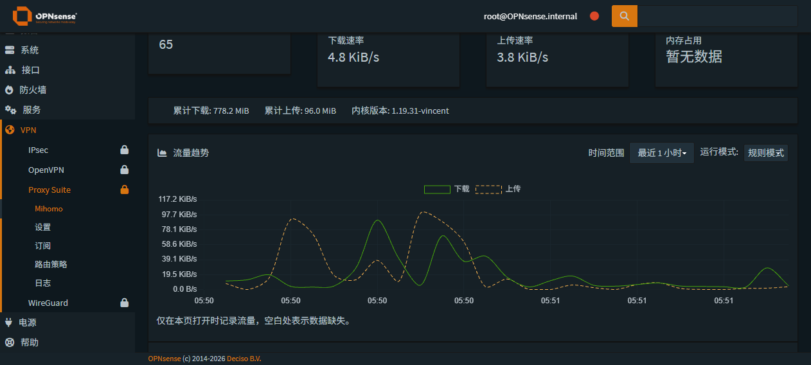

# 原生界面实现 · 2026-10-24

本轮将已确认的界面调整实施到原生 MVC。保留原有 OPNsense 主题、组件和服务端 API 代理。

- 概览移除常驻安全/差异横幅，不增加独立覆盖对照。唯一配置对照仍在设置页。
- 流量、累计量及连接表统一保留一位小数；内存缺失显示“暂无数据”。
- 流量曲线可切换最近 1 分钟、5 分钟、15 分钟、1 小时。每个标签页缓存最多一小时、1800 个样本；只有页面打开时才采集。计数器重置、请求失败及页面休眠均显示缺口，历史不会伪造。
- 图表从当前主题 text-info/text-warning/table 的计算样式取色，上传使用虚线；页面和主题样式加载变化时重算。没有固定深浅色板或主题开关。
- 原生高级模式收纳控制器、TUN 细项和 DNS 上游。高级配置页默认只读，显式解锁后编辑，保存前展示改动，继续沿用服务端备份和校验。只读子标签隐藏设置页 Apply。
- 锁定下拉直接显示已选值；日志错误态保留上一次内容，并修复 HTML 实体显示。
- 新界面中英文词条及 gettext 模板齐全，JS 译文使用 JSON 编码，避免法语等译文的撇号破坏脚本。

验证记录将随真机验收和 GitHub Actions 结果补全。验证只查看配置、切换显示和编辑器本地状态，未保存任何实际设置。

