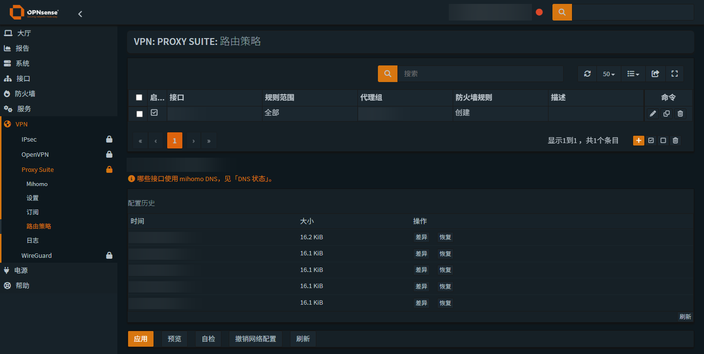
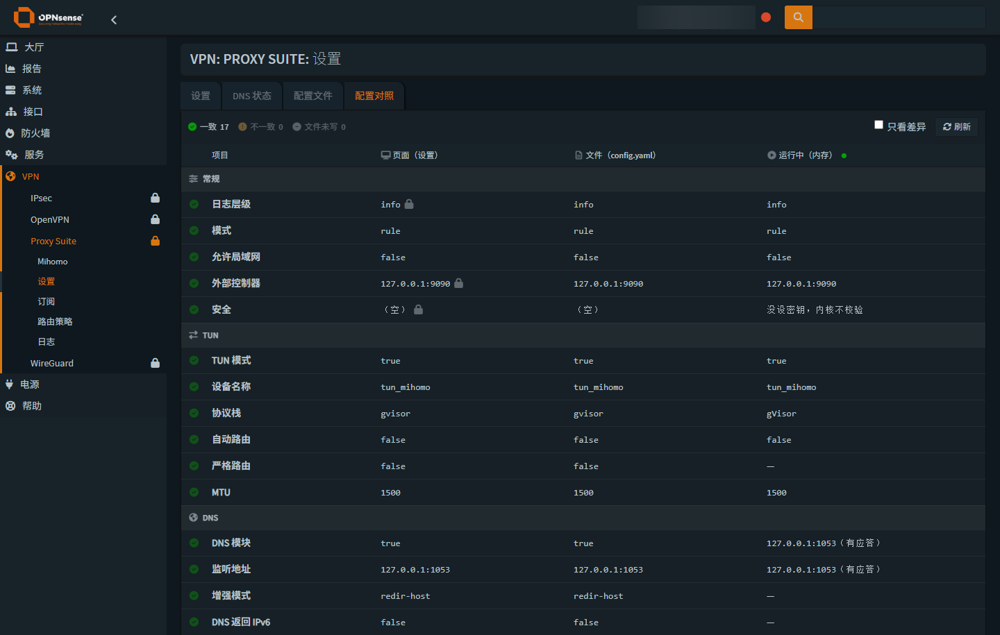

# Using os-mihomo

[Back to project home](../README.US.md) · [Installation and upgrades](install.en.md) · [简体中文](usage.md)

## First-time setup

1. Open **VPN → Proxy Suite → Settings**. Save your own Mihomo configuration in the **YAML editor**, or enter subscription settings and update them from **Subscription**. The shipped examples contain placeholder nodes and credentials. Set a unique controller secret and keep its listener on the appliance loopback address, such as `127.0.0.1:9090`. The WebGUI reaches the controller through the OPNsense backend.
2. **Validate the configuration and check its scope before starting.** You can view the menu and pages with the service stopped. To test a start, use an isolated environment with TUN, automatic routing, DNS and DNS interception disabled, and keep `allow-lan: false`. The shipped YAML and subscription template enable TUN, automatic routing and DNS. Use **Validate** or **Validate and save** to check the YAML after editing or updating a subscription.
3. When ready, start Mihomo using the WebGUI service controls. Check the process and controller in the overview and logs. Start at boot is a separate setting you can enable after verifying operation.
4. To route client traffic through Mihomo, start with a test interface. Under **Policy Routing**, choose the interface, outbound and rule management mode, then preview and apply. Automatic management can change OPNsense interfaces, gateways or firewall rules. In manual mode, the administrator manages those settings. Verify client connectivity, DNS and the actual loaded firewall rules.

## Everyday tasks

| Task | Where to go |
| --- | --- |
| Check core status, rates, traffic or active connections | **Mihomo** overview. Traffic charts sample while the page is open. Client traffic totals cover active connections and lose a connection's totals when it ends. |
| Find, test or select a proxy | **Proxy Groups** in the overview. Filtering, sorting, favorites and notes affect your local view. Test one node or group, or stop queued tests in a batch. Experimental automatic testing and switching default to off. |
| Inspect or close active connections | **Active Connections** in the overview. Search by address, host or process and inspect each connection's matched rule and proxy chain. **Close visible connections** applies to the captured rows on the current page. **Close all** affects all active connections. |
| See which rules are loaded | **Runtime rules** under **Policy Routing** lists top-level rules loaded by Mihomo. **Current forwarding** shows observed PF rules. Check from a client because rule order, exceptions and core policy can affect actual traffic. |
| Update a subscription or diagnose a problem | **Subscription** shows task progress, exit status and last success. **Log File** filters loaded logs by source, text and severity and can download the filtered result. |

Proxy selection snapshots store group and member names for manual selection groups in the browser. Preview before restoring. If a restore fails partway, completed changes remain applied. Favorites, notes and selection snapshots are removed when you clear the browser's site data.

## Change settings and recover configuration

Saved form settings, YAML on disk and the values running in the core can differ. **Settings → Configuration comparison** displays all three. Its exported JSON is a diagnostic snapshot. It omits secrets but can still contain addresses and other details. Use configuration history or an original backup to recover settings.

- **Apply** writes unlocked YAML fields and plugin settings. Locked fields retain the values in the file. The YAML editor lets you preview edits and validates the file before replacement. Restart from the WebGUI when you need the running core to load new settings.
- If the page reports a conflict, reload and review the latest configuration before resubmitting. A **partial** result calls for checking which steps succeeded before retrying. Check process status and logs after a start or restart request is accepted.
- Combine privileges by role. **Mihomo (view)** covers status and redacted logs, **Mihomo (operate)** covers runtime controls, and **Mihomo (configure)** covers settings, history and credentials. The existing full **Mihomo** privilege is still supported. Some native settings save and import operations require full administrator privileges.

## Update subscriptions

An update combines the subscription nodes with the local template and regenerates `config.yaml`. Keep rules and groups you want to retain in the template. In the WebGUI you can update the file only or restart after updating. CLI and scheduled updates retain their existing restart behavior. Check the task result on the Subscription page.

The default converter at `https://subconverters.com/sub` receives the **full subscription URL, including its token**. If your provider returns Clash YAML containing `proxies`, set `MIHOMO_CONVERTER_URL='direct'` in the administrator-only `sub/env` file to fetch nodes directly. If conversion is needed, you can use an HTTPS service you trust. The controller secret is inserted into the configuration locally.

## Troubleshooting

| Symptom | Check first |
| --- | --- |
| Menu or backend actions are missing after installation | Confirm package registration and privileges, then follow the [installation checks](install.en.md#check-the-installation). |
| The menu opens, but the overview has no runtime data | Check service status and logs. Confirm that the controller port and secret in the YAML match the running instance. |
| Applying a form appears to do nothing | Check the field's lock. If the file value changed but the runtime value did not, use configuration comparison and decide whether to restart. |
| A subscription update failed | Check the subscription log and exit status. Confirm that the provider's format matches your converter setup before retrying. |
| Client traffic is not following the expected path | Check policy routing, current forwarding, active connections and DNS status, then verify from a test client. Resolve active traffic dependencies before stopping or removing Mihomo. |

## Configuration files

Keep these files in addition to the OPNsense configuration export before upgrading, migrating or recovering. Handle the copies as credential-bearing backups.

| File | Purpose |
| --- | --- |
| `/usr/local/etc/mihomo/config.yaml` | Mihomo configuration |
| `/usr/local/etc/mihomo/sub/template_config.yaml` | Subscription template |
| `/usr/local/etc/mihomo/sub/env` | Subscription settings and credentials |
| `/etc/rc.conf.d/mihomo` | Start-at-boot setting |

Core and subscription logs are stored in `/var/log/mihomo.log` and `/var/log/mihomo_sub.log`. Check logs or comparison reports for addresses, identifiers and credentials before sharing.
