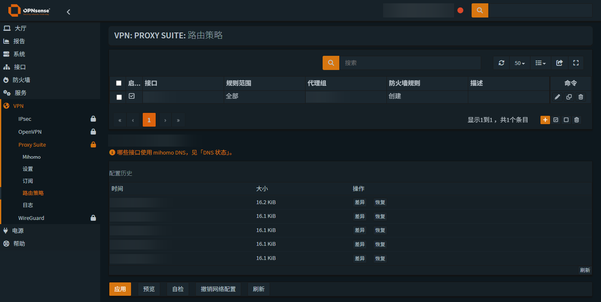
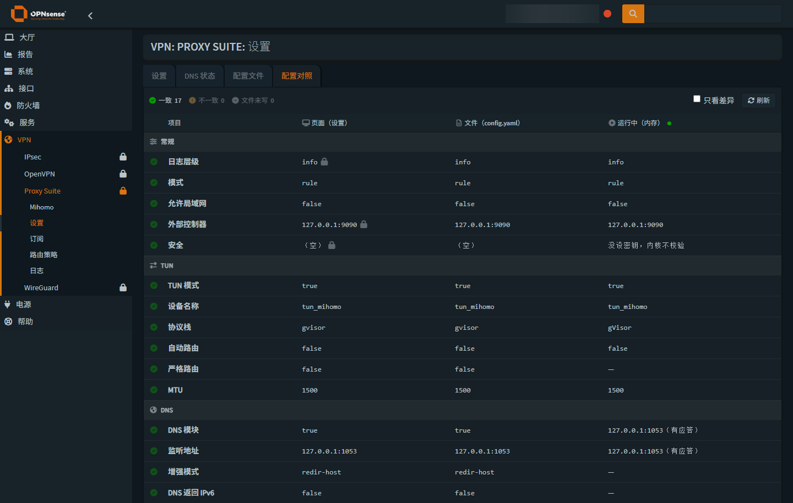

# os-mihomo 使用指南

[返回首页](../README.md) · [安装与升级](install.md) · [English](usage.en.md)

## 首次配置

1. 打开 **VPN → Proxy Suite → Settings**。在 **YAML 编辑器**保存自己的 Mihomo 配置，或填写订阅参数后从 **Subscription** 更新。随包样例含占位节点和凭据。为控制器设置独立密钥，将监听地址保持在设备回环地址（例如 `127.0.0.1:9090`）。WebGUI 通过 OPNsense 后端访问控制器。
2. **先验证配置和启动范围。** 只需查看菜单和页面时，可以保持服务停止。需要试启动时，在隔离测试环境关闭 TUN、自动路由、DNS 及 DNS 劫持，并保持 `allow-lan: false`。随包 YAML 和订阅模板默认启用 TUN、自动路由及 DNS，请在启动前检查。编辑或订阅更新后，用 **校验**或**校验并保存**检查 YAML。
3. 准备妥当后，从 WebGUI 的服务控制按钮启动 Mihomo，在概览和日志确认进程及控制器可用。开机自启是独立设置，确认运行符合预期后再决定是否启用。
4. 如要让客户端经过代理，从测试接口开始。在 **Policy Routing** 明确选择接口、出口及规则管理方式，预览变更，再确认应用。选择自动管理时会改动 OPNsense 的接口、网关或防火墙规则；手动模式由管理员维护网络规则。核对客户端连通性、DNS 和防火墙实际加载的规则。

## 日常操作

| 想做什么 | 去哪里 |
| --- | --- |
| 查看内核状态、速率、流量或活动连接 | **Mihomo** 概览。流量曲线在打开页面后开始采样。客户端流量统计的是当前活动连接，连接结束后不再计入。 |
| 查找、测试或切换代理 | 概览的 **代理分组**。筛选、排序、收藏和备注只管理本地显示。节点或分组可以单独测速，也可以停止尚未发出的批量测试。实验性自动测速和测速后自动选择默认关闭。 |
| 管理已连接的客户端 | 概览的 **活动连接**。可以按地址、主机或进程搜索，查看匹配规则与代理链。**关闭可见连接**只处理确认时该页的连接，**关闭全部**会影响所有活动连接。 |
| 查看正在使用的规则 | **Policy Routing** 的 **运行时规则**查看 Mihomo 已加载的顶层规则。**当前转发**显示观察到的 PF 规则。实际流量仍受规则顺序、例外条件和内核策略影响，应从客户端验证。 |
| 更新订阅或定位故障 | **Subscription** 查看更新任务、退出状态和最近成功时间。**Log File** 按来源、文本和级别过滤已载入的日志，可下载筛选结果。 |

浏览器里的代理选择快照记录手动选择组的组名和成员名。恢复前先预览；若逐组恢复中途失败，已完成的更改仍生效。收藏、备注和选择快照随当前浏览器存储保留，清除站点数据会移除它们。

## 修改设置与恢复

表单值、磁盘 YAML 和正在运行的配置可能不同。**Settings → 配置对照**会并排显示这三类值。导出的 JSON 用于排障，会省略密钥，但仍可能包含地址等信息。恢复配置请使用原始备份或配置历史。

- **应用**可写入解锁的 YAML 项及插件设置。锁定项保留文件值。YAML 编辑器要先点击编辑，保存前可以预览，文件通过校验后才会替换。文件写入后如需让运行中的内核载入，请在 WebGUI 中按需重启。
- 页面提示配置已变化时，重新载入并检查差异再提交。收到**部分完成**时，查看结果和服务状态，确认哪一步需要重试。启动或重启请求已接受时，继续确认进程和日志。
- 权限按职责组合。**Mihomo (view)** 用于状态与脱敏日志，**Mihomo (operate)** 用于运行控制，**Mihomo (configure)** 用于设置、历史和凭据。原 **Mihomo** 全权限继续兼容，部分原生设置保存和导入操作仍需要完整管理员权限。

## 更新订阅

订阅更新将节点写入本地模板并重新生成 `config.yaml`。希望保留的规则和代理组应维护在模板内。WebGUI 可选择只更新文件，或更新后重启。命令行和定时任务保留原有重启行为。更新后在订阅页确认任务结果。

默认转换器 `https://subconverters.com/sub` 接收**完整订阅 URL，包括其中的令牌**。如果提供商直接返回含 `proxies` 的 Clash YAML，建议在仅管理员可读的 `sub/env` 中设置 `MIHOMO_CONVERTER_URL='direct'`，由路由器直接取节点。需要转换时，可改用自己信任的 HTTPS 转换服务。控制器密钥由本机写入配置。

## 排障

| 症状 | 先检查 |
| --- | --- |
| 菜单缺失或安装后动作不可用 | 确认包已登记、账户有权限，再按[安装后检查](install.md#安装后检查)处理。 |
| 页面有菜单，概览没有运行数据 | 检查进程状态及日志，核对当前运行实例的控制器端口和密钥是否与 YAML 一致。 |
| 表单应用后没有改动 | 查看该项是否锁定。如果文件已有新值、运行值仍旧，请查看配置对照并确认是否要重启。 |
| 订阅任务失败 | 查看订阅日志和退出状态。先确认提供商输出格式与转换设置，避免重复提交更新。 |
| 客户端转发异常 | 查看路由策略、当前转发、活动连接与 DNS 状态，再从测试客户端核对。准备停止或卸载前，先处理仍依赖 Mihomo 的流量。 |

## 配置文件

升级、迁移或故障恢复前，除 OPNsense 配置备份外，请另外保存以下文件。按含凭据的备份管理。

| 文件 | 用途 |
| --- | --- |
| `/usr/local/etc/mihomo/config.yaml` | Mihomo 配置 |
| `/usr/local/etc/mihomo/sub/template_config.yaml` | 订阅生成模板 |
| `/usr/local/etc/mihomo/sub/env` | 订阅参数与凭据 |
| `/etc/rc.conf.d/mihomo` | 开机自启设置 |

内核与订阅日志分别位于 `/var/log/mihomo.log` 和 `/var/log/mihomo_sub.log`。分享日志或配置对照前，请再检查其中的地址、标识和凭据。
